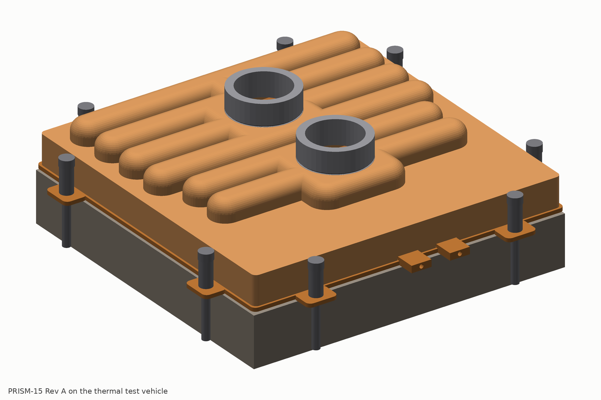

# PRISM-15 Rev A: parametric CAD package

Parametric CAD of the cold plate defined in `../03-architecture.md` (architecture) and `../05-detailed-design.md` (design definition), built with CadQuery 2.8 on OpenCascade from one parameter file, `../design/params.json`. Every part is a real solid with its real features: 360 skived fins with 15 kerf lines, 756 graded orifices in the meter web, windows and recesses in the land plate, the folded plenum with bleed holes, the drawn cap with six arches, two cross domes and the outlet spine, the piloted port bosses, the GUARD-C mesh cup, ears, tap bosses and datum pins. The cap, bosses, guard and separator windows follow the cap lane's design of record (`../design/DDD-cap.md`, `../design/params-cap.json`).



## Files

| Folder | Contents |
|---|---|
| `out/*.step.xz` | STEP AP214 per part, xz-compressed (`xz -d file.step.xz` to expand). The core is 89 MB expanded, 7.6 MB compressed. `prism15_revA_assembly.step.xz` is the full assembly with one node per part |
| `out/*.stl` | tessellated meshes per part (0.05 mm chord tolerance) and the four section solids |
| `out/*.json` | per-part build reports: validity, solid count, volume, mass, bounding box; `assembly_report.json` has the interference and mass checks |
| `out/plenum_flat.dxf` | developed flat pattern of the folded plenum with fold lines and pierced features |
| `drawings/*.svg` | orthographic top, front, right and isometric views of each copper part and of the assembly (hidden lines off; the core views use the coarse LITE fin field) |
| `drawings/artwork_prism15_ttv.dxf` | the inlet-orifice and outlet-row artwork for the 15 kW test plate, true position, for laser piercing |
| `drawings/artwork_prism_g_example.dxf` | zoned artwork example for a four-die GPU package |
| `drawings/separator_windows.dxf`, `drawings/plenum_flat.dxf` | 2-D patterns for the separator and the plenum blank |
| `drawings/dims_*.csv` | the parameter table of each part, flattened from `params.json`, for the drafter |
| `renders/*.png` | report figures: hero, exploded, top, underside, per-part views, fin close-up, four sections and two section close-ups |

## Conventions

- Units mm. X runs along the fins (across the 15 lines), Y along the lines, Z up from the die face. The origin is the centre of the fin field on the die face (datum A at z = 0).
- Parts are modelled in their assembled position, so the assembly is a plain union of the part files.
- Stack: die face 0 | base to 0.85 | fins to 2.80 | grate land plate to 4.10 | meter web to 4.50 | plenum to 10.30 | separator to 12.10 | cap lid to 13.10, arch and dome crowns to 20.80 (internal crown 19.80) | port bosses to 29.5 (pilot underside at 19.80 in the d26.1 pockets). The cap skirt runs down to the core land at z 1.5 (inner 121.5 on the rim lap face 121.4, outer 123.4; the land is exposed 0.8 mm outboard).

## Checks (full-resolution build, `out/assembly_report.json`)

| Part | CAD mass (g) | Design lane mass (g) | Valid solid |
|---|---:|---:|---|
| Core (base, fins, kerfs, rim, land, ears, tap bosses) | 285.1 | 282 | yes |
| Grate land plate | 140.8 | 149 | yes |
| Meter web (756 orifices) | 50.1 | 52 | yes |
| Plenum corrugation | 136.2 | 132 | yes |
| Plenum end frames (2) | 31.2 | 30 | yes |
| Separator (46 windows 5 x 8, IR-C1) | 208.4 | 174 (plenum lane, with 5 x 10 windows and a different set) | yes |
| Cap (drawn, skirted; DDD-cap.md section 3) | 233.6 | 279 (cap lane developed-area estimate; see the note below) | yes |
| Port bosses (2, with d25.95 pilot) | 37.4 | 38 | yes |
| Guard GUARD-C (0.1 mm shell) | 3.3 | 6 (mesh + frame) | yes |
| Screws (8) | 24.7 | provisional (mech lane) | yes |
| **Plate total (no frame, no test vehicle)** | **1151** | **1240 target; cap lane boundary 1307** | |

- Height at the arch and dome crowns 20.8 mm (architecture 20.8; the cap lane's 7.7 mm internal arch recovers the 0.3 mm the plenum lane's 1.8 mm separator had added), 29.5 mm to the top of the port bosses. The 316L stubs (to z 59.5) are not modelled.
- Interference check of twenty pairs (the stacked copper layers, the cap against the core and against every part inside its skirt, the bosses and the guard against the cap and each other): all zero volume. The 121.5 skirt sits on the rim lap face 121.4 with 0.05 mm radial gap and clears the separator and grate (121.0) by 0.25 mm, the plenum flange tips (CAD 121.02) by 0.24 mm and the end frames by 0.40 mm; the skirt is notched over the two core tap bosses.
- Cap mass: the CAD solid at a uniform 1.0 mm wall is 233.6 g (mid-surface area x 1.0 x 8.94 gives 239 g). The cap lane's 279 g sums the full 123.4 sq lid area and then adds the arch and dome developed areas, i.e. it counts the lid under the arch and dome footprints (about 7,100 mm2, 64 g) a second time; the BOM should use the CAD figure once the lane confirms.
- Masses are from solid volumes with OFE copper at 8.94 g/cm3 and stainless at 7.95 g/cm3.

## Regenerating

```
cd docs/cooling/cad
PRISM_CAD_LITE=1 python3 parts/core.py      # coarse fins (36 instead of 360), seconds, for development
python3 parts/core.py                       # full resolution: ~3 min kerf cut, ~6 min STEP write
python3 parts/grate.py parts/plenum.py parts/separator.py parts/cap.py
python3 parts/hardware.py                   # port bosses, GUARD-C, screws, load frame, test vehicle
python3 assembly.py                         # interference, masses, assembly STEP, section solids (about 6 min)
python3 render_views.py                     # report figures (depth-buffer renderer, no GPU needed)
python3 drawings.py                         # SVG views, DXF patterns, dimension tables
```

Needs `cadquery`, `numpy`, `pillow`, `ezdxf` and `xz`. Scripts locate the repository relative to their own path.

## Known simplifications and open discrepancies

- The kerfs are modelled at full depth over the whole fin length; the saw run-out ramp (full depth only for |y| below 48.1 mm) is not modelled.
- The 0.15 x 0.08 mm capillary-break laser scribes on the land plate are not modelled.
- Orifice corner radii (0.1 mm) are not modelled; areas are within 2 % of the artwork.
- The plenum's wall end tabs and the comb slots in the end frames are not modelled.
- Grate and separator outline is 121.0 mm (core lane recommendation, confirmed by the cap lane's IR-C2) where the grate lane wrote 122.6 mm; the datum pins follow the core lane (2.0 mm at +/-57.5) where the grate lane wrote 3.0 mm at +/-57. Both are flagged for the design synthesis.
- Cap: the arch and dome walls are a uniform 1.0 mm (the drawn part thins to 0.92 at the crowns and 0.70 at the arch ends, DDD-cap.md section 7); the 0.5 mm outer radius at the valley feet and the 0.3 rim chamfer filler reservoir are not modelled (the valley braze land is modelled 2.0 wide, sharp). The port pockets are modelled as d26.1 openings through the 1.0 mm crown; the boss pilot (d25.95 x 1.0, underside at the internal crown z 19.8) closes them. The outlet spine is modelled as a channel running from inside the outlet dome's crown flat to the arch-4 centre line (record: y 40 to 54).
- Cap arch ends: with the plan end radius equal to the half width (half cup), the straight arch ends at |x| 45 (inlet) / 51 (outlet) while the outermost separator windows reach |x| 48.79 / 54.95, so their outer corners sit under the arch end wall: 0.54 mm2 (1.3 %) of each of the four x = +/-46.29 inlet windows and 0.81 mm2 (4.0 %) of each of the eight x = +/-53.7 edge outlet windows. The arch mechanical limits (52.0 / 58.8) leave room to lengthen the arches by about 1 mm; cap and plenum lanes to decide.
- Bosses: the stub-seat counterbore (d23 H8 x 8.0 deep) and its face O-ring groove are not modelled (the lane's 19 g per boss also excludes them); the 316L stubs are not modelled.
- Guard: GUARD-C is a 0.1 mm shell (mesh wall d30, flat bottom, top annulus, 0.5 mm frame ring d28 against the crown underside, collar d19.6 x 3.0 into the boss bore); the corrugated bottom, the four 2.0 mm feet and the hook tabs are not modelled. It is modelled hanging from the inlet dome crown (z 14.8 to 19.8); `params-cap.json` places it on feet at z 14.1 to 19.1 (0.7 mm lower). The frame ring is d28 rather than d30 because the r 3.5 crown fillet brings the ceiling down to z 19.65 at r 15.
- Guard choice: GUARD-C (17.4 cm2, 0.40 kPa clean, inside the braze boundary) is modelled; the cap lane recommends discussing GUARD-A (25 cm2 pleated element in a d34 x 40 housing on the inlet stub, 0.2 kPa, +12 mm at the port, plate unchanged) with the first customer ICD (O-C3). If GUARD-A is chosen the inlet dome stays empty and `guard` is dropped from the plate.
- Open items left by the cap lane (DDD-cap.md section 10): O-C1 E1 FEA of the outlet and inlet dome walls and top ligaments with the boss ring (bounds 28-48 MPa at 3.1 MPa); O-C2 E1 FEA of the skirt wall with a wetted stack-edge cavity and lap seam fillet continuity on the first five plates by section; O-C3 GUARD-C vs GUARD-A decision with the ICD and the E4 fouling dose; O-C4 Build A draw trial on soft tools (arch-end thinning map >= 0.70, valley r 0.5 restrike, land flatness 0.05); O-C5 this CAD regeneration and interference re-check (done here: all pairs zero).
- The screws and the load frame are provisional from the architecture; the mechanical design lane refines them.
