## 0. Executive summary

**What this is.** PRISM-15 Rev A is a single-phase, all-copper, direct-liquid-cooled cold plate designed to beat CoolIT Systems' 15 kW cold plate (tech brief, June 2026) at CoolIT's own operating point and in CoolIT's own units. This report is the design package: the architecture of record carried through to a dimensioned design, a parametric CAD model with STEP, STL and 2-D artwork files, the manufacturing route, the predicted datasheet, and the programme that turns the model into measured hardware.

**How it works, in three sentences.** A split-flow plate sends every parcel of coolant 54 mm along the fins, so the far edge runs on coolant that has already warmed by 12.7 K, and the long path forces coarse 0.2 mm fins to hold pressure drop down. PRISM feeds a fine skived fin field (0.15 mm fins at 0.15 mm gaps) through fifteen metered lines, so every parcel travels 7.7 mm, every fin segment starts at inlet temperature, and the fin geometry is chosen for heat transfer and fouling rather than for pressure drop. The fin tips are brazed to the manifold grate, so a 0.85 mm base carries the coolant pressure without bowing and holds a phase-change pad or liquid metal at its rated resistance.

**Scorecard at CoolIT's test point** (15 kW, 18 LPM PG25, 45 °C inlet, 117 cm² heated area; PRISM values are model predictions, ±25 % per term until tested).

| Metric | CoolIT 15 kW | PRISM-15 Rev A | Verdict |
|---|---|---|---|
| Average case-to-inlet rise, same paste class | 34.4 K (measured) | 31.0 K | win, P ≈ 0.8 |
| Maximum case-to-inlet rise, same paste class | 44.2 K (measured) | 38.7 K | win, P ≈ 0.9 |
| Average / maximum on a phase-change pad | ≈ 32.5 / 40.3 K (estimate) | 29.0 / 34.8 K | win |
| Average / maximum with liquid metal (Tier 2) | – | 23.9 / 28.8 K | stretch |
| Plate pressure drop at 18 LPM, 20 mm ports | undisclosed; ≈ 22 kPa reconstructed | 7.6 kPa | win |
| Load at 85 °C case, 1.2 LPM/kW, paste / pad | 12.9 / 14.8 kW | 15.7 / 18.5 kW | win |
| Inlet temperature allowed at 15 kW, paste / pad | 40.8 / 44.7 °C | 46.3 / 50.2 °C | win |
| Height at the headers / mass | ≈ 22–28 mm / 1.2–1.6 kg (estimate) | 20.8 mm / 1.3 kg | parity to win |
| Factory cost per plate at 100k/yr | ≈ US$126 | US$165 | loss (cost per kW at parity) |

**What it does not win.** Price per plate (+31 %), field record, fouling life at equal filtration (it ships with a 33 µm tray filter), the average temperature at very low flow or if CoolIT's heaters were only 100 cm², and CoolIT's small 4 kW single-die point with the drop-in core. These are stated in full in section 10.

**Design status.** The design definition is complete for every layer: core, grate, plenum and separator, cap and bosses, mounting, manufacturing route, predicted datasheet and innovation register. The CAD assembly of fourteen parts is regenerated from the lane values and checked for interference (section 9). The cap lane closed the grate-outline conflict at 121.0 mm; the datum-pin diameter, the ear-hole size, the mass recovery and the guard variant are the items left for the Rev A freeze at gate G1. No hardware exists yet: the first braze coupons, a water-table flow test and purchased incumbent plates are the first three months of the programme.

**Decisions requested** (detail in section 13): approve the scoped public claim rather than "beats on every metric"; fund in tranches, US$2.3 M to gate G1 at month 3; adopt the vacuum-braze Rev A build with the silver-free Cu-Sn joint decided at G1; make the 33 µm tray filter a supplied part; hold US sales until the freedom-to-operate opinion clears.

## 1. The benchmark and the rules of the comparison

CoolIT's brief reports one operating point: 15 kW from four ceramic heaters, 18 LPM of water-glycol at 45 °C inlet, three plates each read by eight thermocouples at the heater surface, standard thermal paste. The averages are 34.4 K case-to-inlet (plate means 32.5, 35.2 and 35.6 K) and the hottest reading is 44.2 K. The brief does not give the pressure drop, the heated area, the paste identity, the height, the mass or the thermal resistance against flow.

Our reconstruction, built in the research phase and documented in `docs/cooling/01-benchmark-and-requirements.md`, puts the heated area at about 120 cm² (photogrammetry of the brief's own photographs, 100 to 145 cm² band), which makes the plate a 0.27 cm²·K/W device at 128 W/cm². A one-dimensional model calibrated to that footprint reproduces the measured 34.4 K and decomposes it as coolant rise 6.3 K, paste 9.0 K, 2 mm base 6.6 K and convection 12.6 K. The plate pressure drop is bounded at about 22 kPa (17 to 42 kPa band) from the fin geometry a skived split-flow plate must have to reach that convection term.

The arbiter for the public claim is the OCP Single-Phase Direct-to-Chip Cold Plate Test Specification v1.0.0 (effective September 2026), whose primary author also wrote CoolIT's brief. Every PRISM number in this report is therefore stated the way that specification measures: case-to-inlet resistance with the thermal interface included, at a stated flow, with the pressure drop at a stated boundary. The comparison rules we impose on ourselves: paste and pad results published separately with the measured bond line; two test vehicles (117 cm² parity and 100 cm² hard mode); the eight-thermocouple layout replicated; pressure drop at three boundaries (port-to-port with bore stated, with barbs, with a named quick-disconnect pair); five plates by three re-mounts with an independent ISO/IEC 17025 repeat.

## 2. The mechanism

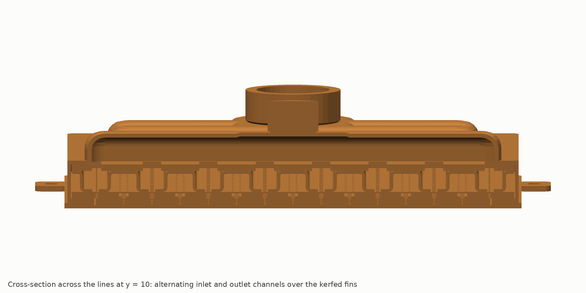

The cross-section above, taken from the CAD assembly across the fifteen lines, shows the whole mechanism in one picture. From the bottom: the 0.85 mm base and the 2.0 mm fin field, cut by 0.3 mm kerfs at every line; the 1.3 mm grate land plate with a 1.2 mm window over each kerf and, at inlet lines, a 2.7 mm recess; the 0.4 mm meter web with its graded orifices; the folded plenum whose channels alternate inlet and outlet at 7.7 mm pitch; the separator; and the drawn cap with its arches.

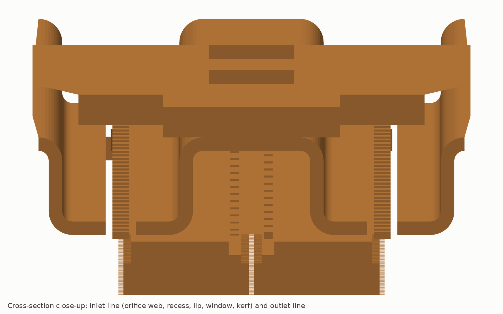

Coolant arrives in an inlet plenum channel, passes through a 0.5 × 1.05 mm orifice in the web (1.54 m/s, 2.3 kPa), drops through the recess onto the grate lip rather than onto the fins, turns into the 1.2 mm window and the kerf, and enters each fin segment over its full height. It runs 7.7 mm along 0.15 mm gaps at 0.20 m/s, leaves through the kerf and window at the neighbouring outlet line, passes the 0.5 kPa outlet orifice row that balances the two segments either side of a line, and collects in the outlet channels, the four outlet arches and the outlet boss.

Three design rules do most of the work:

1. **Flow length graded by heat flux.** The two-dimensional cell model shows the average case temperature falling with cell length at every flux, while the case ripple is flat between 5 and 8 mm. The 15 kW test plate uses 7.7 mm; a GPU package uses 5 to 6 mm over the dies and 12 mm over memory and margins. This rule turned the architecture's one conceded loss on uniform low-flux lids into parity.
2. **An inertial meter off the braze plane.** The orifices sit in a separate 0.4 mm web, 1.3 mm above the fin-tip joints, so braze fillets cannot reach them, and their sizes (five steps over 1.13:1 in area) cancel the plenum's static-pressure profile at every flow because both scale with velocity squared. Per-orifice flow is uniform within ±2.2 %.
3. **Ties.** Every fin tip is brazed to the grate lands over at least 70 % of its length. The base then sees only the pressure between ties 0.3 mm apart, so it can be 0.85 mm thick with zero pressure bow, which is what lets a pad or liquid metal hold its datasheet resistance over a 108 mm face.

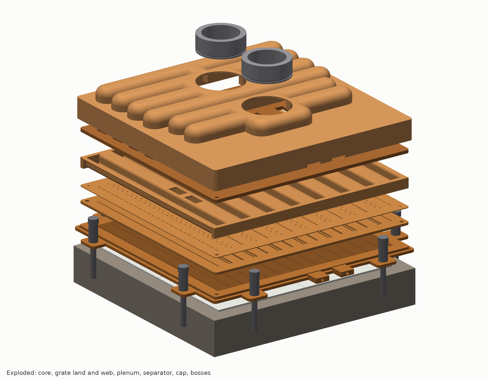

## 3. Design definition, layer by layer

All dimensions in mm. Axes: X along the fins (across the lines), Y along the lines, Z up from the die face (datum A). The full tables are in `docs/cooling/design/params.json` and the lane documents `DDD-*.md`; the flattened dimension tables per part are in `docs/cooling/cad/drawings/dims_*.csv`.

### 3.1 Core: base, fin field, kerfs, rim, land, ears

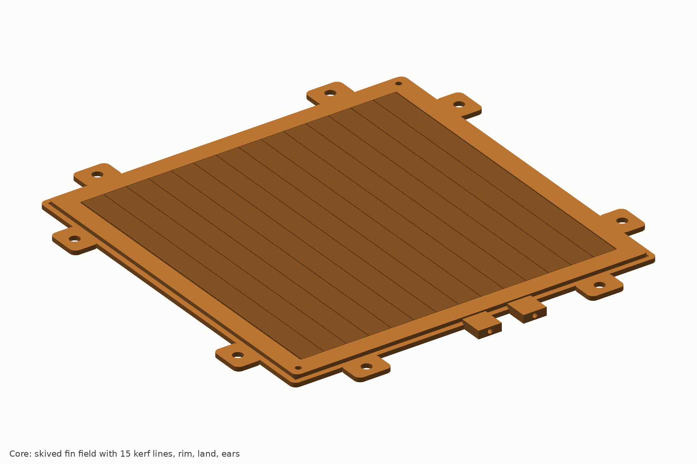

| Feature | Value | Tolerance | Basis |
|---|---|---|---|
| Material | OFE copper C10100, H02 plate 4.3 mm, skived at 2.0 mm base, fly-cut to 0.85 after braze | – | DDD-core |
| Body | 125 × 125, corner r 2 | ±0.1 | architecture 5.6 |
| Base under the fin field | 0.85 (0.80 min, 1.0 fallback) | +0.05/−0.05 | E1 gate on tie detection |
| Fin field | 108 × 108; 360 fins, 0.15 thick, 0.15 gap, 0.30 pitch, tips at z 2.80 | t ±0.02, pitch ±0.005, tip plane ±0.02 | skiving capability, DDD-core 3 |
| Kerfs | 15 lines at x = −54 + 7.7143 k, width 0.30, floor 0.07 above the fin root | w +0.05/−0, x ±0.03 | gang saw, potted field |
| Pocket | 108.7 × 108.3, r 0.5, wall top z 2.80; 0.35 mm edge channels for the two edge outlet lines | ±0.05 | DDD-core |
| Rim | 121.4 outer, top z 2.80, 6.35/6.55 wide: carries the grate and takes the cap skirt lap on its outer wall | ±0.05 | DDD-core, cap seam |
| Land | 1.8 wide at z 1.5 outside the rim: the one external braze seam | – | architecture 5.1 |
| Ears | 8 lobes 12 wide, 7 protrusion, z 1.5, holes 3.4 (4.5 if M4) at (±40, ±66) and (±66, ±40) | ±0.1 | DDD-core, mech lane |
| Tap bosses | 2 on the −y edge at x 0 and 15.43, 8 wide, 1.0 holes at z 1.4 reaching the inlet kerf k = 7 and outlet kerf k = 9 | ±0.05 | fin-field dP signature |
| Datum pins | 2.0 H7 at (±57.5, ±57.5), alumina pins, 1.5 deep | pos ±0.02 | DDD-core (grate lane wrote 3.0 at ±57: to be reconciled at G1) |
| Die face | flatness 0.02 over the fin field, Ra 0.8, parallel to the ear plane 0.03, concave-only form 0–10 µm | – | DDD-core, DDD-mech 7.3 |

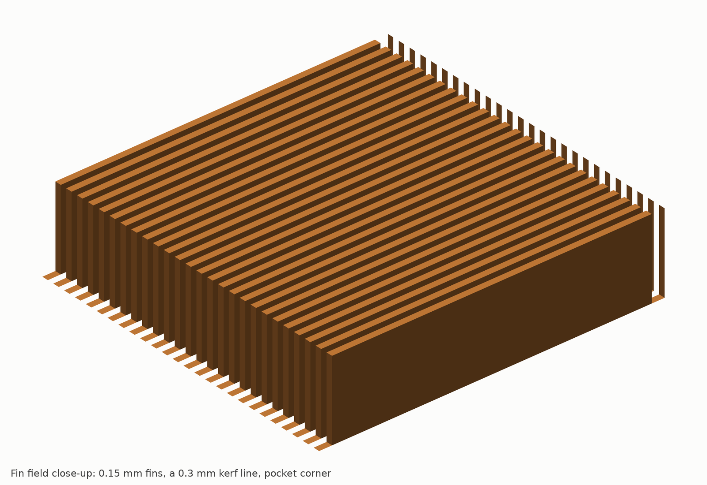

### 3.2 Grate: land plate and meter web

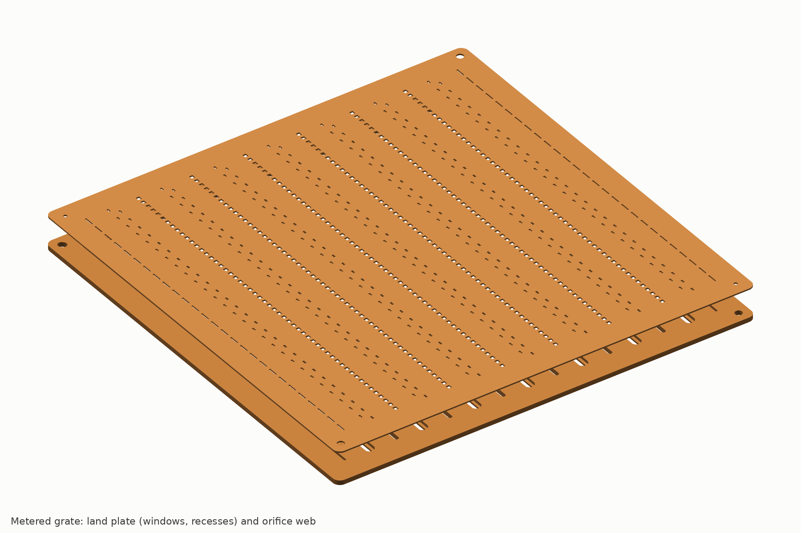

The grate is two laminations brazed in the same cycle, because the recess must open toward the web and no face operation on a single plate can cut that undercut cleanly.

| Feature | Value | Tolerance | Basis |
|---|---|---|---|
| Land plate GRT-L | 1.30 thick, z 2.80–4.10, OFE H02 strip, both faces skimmed | t ±0.02, flatness 0.02 | DDD-grate 3 |
| Windows, 13 interior lines | 1.20 wide × 108 long, rounded ends, centred on the line | +0.05/−0 | 2-D cell model |
| Windows, 2 edge lines | 0.60 wide at x = ±53.7 | +0.05/−0 | half-line flow |
| Recess, 7 inlet lines | 2.70 wide × 0.80 deep from the top, 109 long, floor 0.50 | w +0.05/−0, depth ±0.03 | jet lands on the lip; E2 fixes 0.70–0.90 |
| Lip | 0.75 wide each side of the window (x 0.60–1.35 from the line) | – | spill margin at the RSS tolerance stack |
| Lands | continuous, 6.5 wide between lines, braze mask 0.3 from window edges, bond fraction ≥ 0.70 of fin-tip length | – | tie load path |
| Capillary-break grooves | 0.15 × 0.08 laser scribes 0.775 from each window centre (underside) and along the recess edges (top) | ±0.02 | keeps filler off the window and the orifices |
| Meter web GRT-W | 0.40 thick, z 4.10–4.50, OFE O60/H01 precision strip | t ±0.01 | DDD-grate 4 |
| Inlet orifices | 378: 54 per line at 2.0 pitch, 0.50 wide × 0.99–1.12 long (five size steps), corner r 0.1, alternating ±1.00 from the line so each jet lands on a lip | w, h ±0.01, pos ±0.02 | artwork ART-TTV-15-A |
| Outlet row, interior | 324: 54 per line, 1.00 × 1.12 centred on the line | ±0.015 | 0.50 kPa at 18 LPM |
| Outlet row, edge | 54: 27 per edge line, 0.40 × 2.78 at 4 mm pitch | ±0.015 | 0.50 kPa in the 0.6 window |
| Process | laser pierce from the plenum face, electropolish 3–5 µm, 100 % backlit vision before and after braze; perforating die after artwork freeze | – | DDD-grate 5, DDD-mfg |

Meter hydraulics at 18 LPM: 2.31 kPa, mean orifice velocity 1.54 m/s (1.93 m/s at 150 % of rated flow), discharge coefficient 0.72 assumed (0.65 to 0.80 band, measured on coupons in experiment E2), per-orifice flow spread ±2.2 % at every flow from 9 to 36 LPM.

### 3.3 Plenum and separator

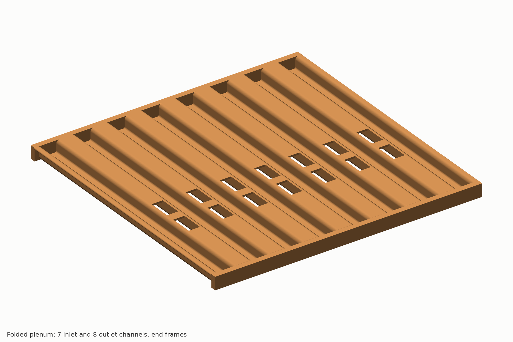

| Feature | Value | Tolerance | Basis |
|---|---|---|---|
| Corrugation PLN-C | one 0.80 mm OFE O60 sheet folded into 16 walls, 7 top flats (inlet lines), 8 bottom flats (outlet lines) and 2 outward flanges; z 4.50–10.30 | pitch ±0.05, t ±0.03 | DDD-plenum 2–3 |
| Channels | 15 at 7.7143 pitch, 6.914 wide × 5.00 tall; walls at x = line ± 3.857, 0.80 thick | – | hydraulics 0.65 m/s max |
| Bends | inside radius 0.6, outside 1.4; K-factor 0.35 (0.31–0.39) fixed on a 3-bend coupon before the die is cut | – | soft copper |
| Developed blank | 180.95 × 116.0; fold lines and pierced features in `cad/out/plenum_flat.dxf` | ±0.05 | DDD-plenum 3.3 |
| Inlet-channel ceiling windows | 2 per inlet line, 5.0 × 10.0 at y −21 and −7, feeding up into the separator and the inlet arches | ±0.1 | plenum solver, win_u ≤ 0.44 m/s |
| Bottom-flat slots | 1.8 × 110 over each outlet row | +0.05/−0 | – |
| Bleed holes | 14 × 1.1 mm at z 7.4, alternating y ±55.5, from each inlet dead-end into the neighbouring outlet | ±0.02 | 4 % of plenum flow, no stagnant corner |
| End frames PLN-F | 2 OFE bars 2.5 × 5.78 × 120.7 with 16 sawn slots receiving 1.0 mm wall tabs | slot ±0.03 | pitch control at both ends |
| Separator SEP | 1.80 thick, z 10.30–12.10, outline 121.0; 14 inlet windows 5 × 8 at (x_in, −21/−7); 32 outlet windows 5 × 8 at (x_out, +7/+21/+35/+49) with 2.5 wide windows at the edge lines; the plenum's top-flat windows stay 5 × 10 | ±0.05 | plenum lane; mech IR-M3; cap IR-C1 (8 mm keeps a 1.0 margin under a 10 mm arch; 0.54 m/s, 0.29–0.44 kPa) |

All plenum and separator joints are internal: a missed joint bypasses a little flow between an inlet and an outlet channel (caught by the infrared flow screen and the pressure-drop test) and can never leak to the outside.

### 3.4 Cap, headers, bosses and guard

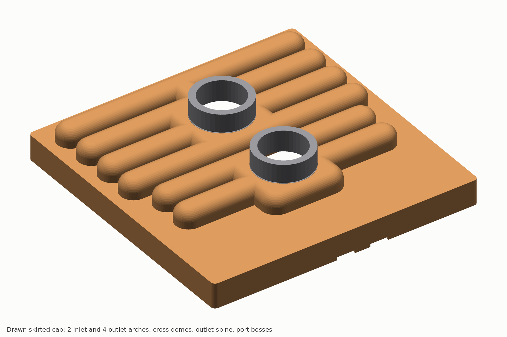

The cap lane (`design/DDD-cap.md`) replaced the provisional 12 × 8 arches. At the 14 mm window pitch a 1.0 mm sheet can only form a brazeable valley between neighbouring arches if the external land is at least 2 mm, which caps the internal width at 10 mm; 7.7 mm of internal height brings the bar back to the architecture's 20.8 mm. A 26 mm boss needs a 28 mm flat under it, which sets the 35 mm cross domes and moves the bosses to y −20 and +21.

| Feature | Value | Tolerance | Basis |
|---|---|---|---|
| Sheet | C10100 OFE 1.00, O60; ≥ 0.70 at the arch ends after draw, 0.92 at crowns and skirt foot | ±0.03 | DDD-cap 7 |
| Lid | flat on the separator, z 12.10–13.10; load-frame lands at |y| 56.5–59.7, x ±60 | z ±0.10; flat 0.05, coplanar 0.08 | mech IR-M2 |
| Arches | 6 at 14 mm pitch; internal 10.0 wide × 7.7 high from the separator top, crown corners r 3.5 internal / 4.5 external, top flat 3.0; external 12 × 8.7; valley land 2.0 with r 0.5 | ±0.15 | section 71.7 mm²; DDD-cap 2 |
| Inlet arches | y −21, −7; internal x ±50 (external ±51); half-cup ends r 5 / 6 | ±0.2 | covers the inlet windows with 1.2 margin; mech limit 52 |
| Outlet arches | y +7, +21, +35, +49; internal x ±56 (external ±57) | ±0.2 | covers the edge windows with 1.05 margin; mech limit 58.8 |
| Header areas per half | inlet 143 mm², outlet 287 mm² (the 2:1 ratio is kept) | – | 1.05 / 0.52 m/s at 18 LPM |
| Inlet cross dome | 35 × 35 internal, y −37.5 to −2.5, top flat 28 × 28 | ±0.2 | joins both inlet arches; 2 mm wall to the outlet system at y ±1 |
| Outlet cross dome and spine | 35 × 38 internal, y +2 to +40, plus a spine 10 wide to y 54 joining arch 4 | ±0.2 | 4.5 LPM at 1.0 m/s in the spine |
| Height | 20.80 at the arch crowns; 29.5 at the bosses | ±0.15 | 12.10 + 1.0 + 7.7 + 1.0 |
| Port pockets and bosses | d26.1 × 1.0 pockets at (0, −20) and (0, +21); OFE bosses OD 26 h9, bore 20 H9, pilot d25.95 × 1.0, z 19.8–29.5; BAg-8 0.6 mm ring at the pilot chamfer | pocket +0.05/−0; position ⌀0.10 | inside the mechanical keep-in |
| Stub seat | counterbore d23 H8 × 8 with a face O-ring groove; 316L stub 20 ID × 23 OD × 30 pressed after the fly-cut and lip-rolled | – | UQD08 adapter or ¾-in barb on the stub |
| Skirt | inner 121.50, outer 123.4, foot z 1.5, inner corners r 1.0; notched over the two tap bosses; 0.8 mm of the core land exposed outside | inner ±0.03, outer ±0.15 | lap gap 0.05 (0.01–0.09) on the rim 121.40 |
| External seam | 1.3 mm tall lap × 485 mm perimeter = 627 mm²; one BAg-8 0.5 mm wire ring, 499 mm, 0.98 g, in the outer foot corner; 0.94 MPa shear at design burst | – | the plate's only external seam |
| Guard GUARD-C | inverted cup d30 × 5.0 of 50 µm absolute 316L weave with a corrugated bottom, 17.4 cm², under the inlet dome at (0, −20); 0.40 kPa clean; installed before braze | – | DDD-cap 6; deviation D-C3 |
| Alternative GUARD-A | pleated 25 cm² element in a d34 × 40 housing on the inlet stub, serviceable, 0.15–0.2 kPa, +12 mm at the port only | – | O-C3, decided with the first customer ICD |
| Mass | cap 279 g, bosses 38 g, guard 6 g, stubs 32 g | ±5 % | blank 188 × 233 × 1.0, 393 g |

Pressure design at 3.1 MPa design burst against the 40 MPa allowable (DDD-cap 4): arch top flat 14 MPa, straight walls 27.3, crown corners 10.8, arch-end half domes at 0.70 wall 22.1, dome top ligament carrying the boss ring 37.8, inlet dome walls 27 to 38 and outlet dome walls 28 to 48 depending on how much the arch walls stiffen them (a bound, FEA in E1 as O-C1), and the skirt wall 44.5 MPa at working pressure only if the stack-edge cavity is wetted through two failed internal joints (a secondary leak-before-break boundary, O-C2). Draw sequence: arches, domes and spine are formed first in the flat blank with free feed (channel draw ratio 1.8, arch-end cups 1.97 against a limiting ratio of 2.1), anneal at 450 °C, skirt box draw 125 square by 11.6 deep, restrike to the final radii, lands and pockets, trim to 123.4, pierce the d20 holes and the tap notches.

### 3.5 Mounting hardware and the load frame

The mechanical lane found that the core's 1.5 mm annealed ears cannot carry spring loads (47 to 195 MPa against a 40 MPa allowable), so every mount uses a load frame that bears on two cap lands at |y| 56.5 to 59.7 mm over the plenum end frames. Eight dia-4 shoulder screws with preset springs give 2,011 ± 80 N on the parity test vehicle (25 psi on 116.6 cm², the pad's datasheet condition), 480 ± 25 N or 880 N on a lidded package (7 or 13 psi), and 0.29 MPa on a bare-die block. The product frame LF-15P is an 85 g 301 stainless stamping; the test frame LF-15T is a fixture. Plate-to-plate clamp repeatability (4 to 5 %) is better than the pad's own pressure sensitivity.

## 4. Orifice artwork and zoning

The meter web is the only part that changes between packages, and it is laser-pierced, so a new zoning is an artwork file and a two to three week turnaround rather than a die. Two artworks ship with this package:

- `cad/drawings/artwork_prism15_ttv.dxf` (ART-TTV-15-A): the uniform 15 kW test plate, 378 graded inlet orifices and 378 outlet-row holes, computed by `design/grate_artwork.py` from the centre-fed plenum pressure profile so that per-orifice flow is uniform within ±2.2 % from 9 to 36 LPM.
- `cad/drawings/artwork_prism_g_example.dxf`: a zoned example for a four-die GPU package (4 × 26 × 33 mm dies at 350 W/cm² plus 16 HBM stacks) on a 110 × 120 mm field, with 17 flux-graded lines (5.5 mm pitch over the dies, 11 mm over memory and margin) and heat-proportional flow: the die block takes about 88 % of the flow and HBM never sits downstream of a die.

The zoning rule from the architecture: flow length 5 to 6 mm above 250 W/cm², 6 to 8 mm from 100 to 250, 8 to 12 mm from 50 to 100, 12 mm below 50; the die block gets 85 to 90 % of the flow; unheated margin gets slot-end bleeds only.

## 5. Predicted performance datasheet

Every number in this section is a model prediction from `model/coldplate_model.py` (v3) and the design lanes' own scripts, re-run on the as-designed geometry (0.85 mm base, 1.8 mm separator) by `design/perf_datasheet.py`. The models were cross-checked against each other and calibrated on CoolIT's one published point; they have not been checked against hardware or three-dimensional CFD. Treat each term as ±25 % until experiments E2 and E3 report.

### 5.1 Term budget at the benchmark point

15 kW, 18 LPM PG25 (k 0.49 W/m·K), 45 °C inlet, 117 cm² heated, eight-thermocouple layout.

| Term (K) | Paste | Phase-change pad | Liquid metal (Tier 2) | Note |
|---|---:|---:|---:|---|
| Coolant caloric rise to the local cell | 7.52 | 7.52 | 7.52 | eps-NTU, NTU 1.16, outlet rise 12.66 K |
| Thermal interface | 8.97 | 7.05 | 1.92 | 0.105 / 0.083 / 0.022 cm²·K/W incl. bond line |
| Base conduction, 0.85 mm | 2.79 | 2.79 | 2.79 | 2.63 at 0.80; 3.29 at 1.0 |
| Convection, fins and base wetted area | 10.94 | 10.94 | 10.94 | h 12.6 kW/m²·K, h_eff 117 kW/m²·K on the footprint |
| Two-dimensional penalty (cell ends, kerf shadow) | 0.87 | 0.87 | 0.87 | own 2-D conjugate cell model |
| **Average case-to-inlet** | **31.1** | **29.2** | **24.1** | CoolIT measured 34.4 (paste) |
| Case ripple, peak to peak, within a cell | 5.39 | 5.39 | 5.39 | – |
| Flow hot-spot allowance | 1.5 | 1.5 | 1.5 | weakest segment uses 0.41 K of it |
| **Maximum case-to-inlet** | **38.8** | **34.9** | **28.9** | CoolIT measured 44.2 (paste) |
| Resistance on the footprint, average (cm²·K/W) | 0.243 | 0.228 | 0.188 | CoolIT ≈ 0.27 |

The as-designed 0.85 mm base costs 0.14 K against the architecture's 0.80 mm; the 1.0 mm fallback costs 0.69 K, and both still beat the benchmark by more than 2.5 K on the average. Channel conditions: 0.198 m/s, Reynolds 44, laminar and fully developed within the first millimetre, fin-channel viscous drop 1.07 kPa.

### 5.2 Flow sweep in the OCP format

15 kW, 45 °C inlet, PG25, 117 cm². R is case-to-inlet temperature over power; R'' is R times the heated area. The CoolIT-like column is our calibrated model of a split-flow plate, patched to CoolIT's measured point at 18 LPM, and is model-only away from it.

| LPM | LPM/kW | Outlet rise K | PCM avg / max K | PCM R'' avg / max | Paste avg / max K | Paste R'' avg / max | LM avg / max K | CoolIT-like paste avg / max K |
|---:|---:|---:|---|---|---|---|---|---|
| 3.75 | 0.25 | 60.8 | 66.9 / 79.0 | 0.522 / 0.616 | 68.8 / 83.0 | 0.537 / 0.647 | 61.7 / 73.0 | 58.8 / 92.6 |
| 7.50 | 0.50 | 30.4 | 41.9 / 50.5 | 0.327 / 0.394 | 43.8 / 54.4 | 0.342 / 0.425 | 36.8 / 44.5 | 43.5 / 62.1 |
| 11.25 | 0.75 | 20.3 | 34.5 / 41.5 | 0.269 / 0.324 | 36.4 / 45.4 | 0.284 / 0.354 | 29.4 / 35.5 | 38.4 / 51.9 |
| 15.00 | 1.00 | 15.2 | 30.9 / 37.1 | 0.241 / 0.289 | 32.9 / 41.0 | 0.256 / 0.320 | 25.8 / 31.1 | 35.7 / 46.8 |
| 18.00 | 1.20 | 12.7 | 29.2 / 34.9 | 0.228 / 0.272 | 31.1 / 38.8 | 0.243 / 0.303 | 24.1 / 28.9 | 34.4 / 44.2 (measured) |
| 22.50 | 1.50 | 10.1 | 27.4 / 32.7 | 0.214 / 0.255 | 29.4 / 36.6 | 0.229 / 0.285 | 22.3 / 26.6 | 33.0 / 41.5 |

Below 0.75 LPM/kW the 15 kW outlet exceeds 65 °C and the test is run at reduced power; resistance is power-independent to first order. The maximum is lower than the split-flow plate at every flow. The average crosses at about 0.5 LPM/kW: below that the split-flow plate's coarse fins and short caloric path win on the average, which is the conceded low-flow point.

### 5.3 Capacity, headroom and uniformity

| Quantity | Paste | PCM | LM |
|---|---:|---:|---:|
| Load at 85 °C maximum case, 45 °C inlet, 1.2 LPM/kW (thermal) | 15.7 kW | 18.4 kW | 25.4 kW |
| Rated load (velocity cap: meter 2.0 m/s at 23.4 LPM) | 15.7 kW | 18.4 kW | 19.5 kW |
| Inlet allowed at 15 kW and 85 °C maximum | 46.3 °C | 50.2 °C | 56 °C |

| Uniformity level | Rev A at 18 LPM | At 27 LPM | Verification |
|---|---:|---:|---|
| Along-plenum max/min (graded meter) | 1.061 | 1.07 | E2 dye and infrared |
| Line max/min (diffused port jet) | 1.03 | 1.03 | E2 |
| Segment max/min (left/right of a line) | 1.06–1.09 | 1.12 | E2 pass ≤ 1.15 at 18, ≤ 1.20 at 27 |
| Weakest segment, extra case temperature | +0.41 K | +0.35 K | inside the 1.5 K allowance |

### 5.4 Pressure drop

PG25 at 45 °C. Plate values are port-to-port with 20 mm bores; 81 % of the drop is inertial, so it scales close to the square of flow.

| Element at 18 LPM | kPa |
|---|---:|
| Ports (K 3.5 combined) | 1.60 |
| Guard, clean (0.1–0.2 expected, 0.30 booked) | 0.30 |
| Headers | 0.99 |
| Separator windows | 0.46 |
| Plenum channels | 0.21 |
| Graded meter | 2.30 |
| Windows, kerf turn, miscellaneous | 0.16 |
| Outlet orifice row | 0.50 |
| Fin channels (viscous) | 1.07 |
| **Plate, port to port** | **7.6** |

| LPM | % of rated | Plate, port to port (20 mm bore) | With stubs and ½-in barbs | With one UQD08 pair, Cv 4.75 / 3.65 | CoolIT-like reconstruction, port to port | Water, port to port |
|---:|---:|---:|---:|---|---:|---:|
| 3.75 | 25 | 0.57 | 0.7 | 1.3 / 1.7 | 3.5 | 0.40 |
| 7.50 | 50 | 1.68 | 2.2 | 4.6 / 6.3 | 7.8 | 1.31 |
| 11.25 | 75 | 3.31 | 4.5 | 9.9 / 13.7 | 13.0 | 2.76 |
| 15.00 | 100 | 5.48 | 7.6 | 17.2 / 23.9 | 19.1 | 4.72 |
| 18.00 | 120 | **7.60** | 10.6 | 24.5 / 34.2 | 24.6 | 6.67 |
| 22.50 | 150 | 11.41 | 16.1 | 37.8 / 52.9 | 33.9 | 10.22 |
| 27.00 | 180 | 15.99 | 22.7 | 54.1 / 75.8 | 44.4 | 14.52 |
| 36.00 | 240 | 27.46 | 39.5 | 95.1 / 133.7 | 69.3 | 25.39 |

External claim: at or below 10 kPa at 18 LPM with 20 mm ports and at or below 30 kPa at 36 LPM. With ½-inch barbs the ratio against the reconstruction falls from 2.7 to about 1.7 because the barbs dominate both plates; with one UQD08 pair (Cv 3.65 to 4.75) the tray-loop figure is 42 to 51 kPa against 56 to 79 kPa. We publish our value against the reconstruction band and never as a measured CoolIT number.

### 5.5 Inlet temperature, coolant and transients

The case-to-inlet rise moves by less than 0.3 K between 35 and 50 °C inlet (the PG25 viscosity shift changes the fin-channel term only), so the case temperature tracks the inlet one for one. Water is 2 K better than PG25 and 12 % lower in pressure drop at the same flow.

| Case (15 kW) | LPM | Pad avg / max K | Case avg / max °C | Paste avg / max K | Case avg / max °C | Outlet °C | Plate dP kPa |
|---|---:|---|---|---|---|---:|---:|
| PG25, 35 °C inlet | 18.0 | 29.3 / 35.0 | 64.3 / 70.0 | 31.2 / 38.9 | 66.2 / 73.9 | 47.6 | 8.05 |
| PG25, 45 °C inlet | 15.0 | 30.9 / 37.1 | 75.9 / 82.1 | 32.9 / 41.0 | 77.9 / 86.0 | 60.2 | 5.48 |
| PG25, 45 °C inlet | 18.0 | 29.2 / 34.9 | 74.2 / 79.9 | 31.1 / 38.8 | 76.1 / 83.8 | 57.7 | 7.60 |
| PG25, 45 °C inlet | 22.5 | 27.4 / 32.7 | 72.4 / 77.7 | 29.4 / 36.6 | 74.4 / 81.6 | 55.1 | 11.41 |
| PG25, 50 °C inlet | 18.0 | 29.1 / 34.8 | 79.1 / 84.8 | 31.0 / 38.8 | 81.0 / 88.8 | 62.7 | 7.43 |
| Water, 45 °C inlet | 18.0 | 27.1 / 33.0 | 72.1 / 78.0 | 29.1 / 36.9 | 74.1 / 81.9 | 57.1 | 6.67 |

At 50 °C inlet the paste maximum passes 85 °C; the pad does not. PG30 and EG25 cost 0.5 and 0.1 K against PG25; a 20 °C cold start raises the fin-channel drop to 2.2 kPa and the plate to about 9 kPa.

**Transients.** The 0.85 mm base holds 0.30 J/K/cm² of near-die heat capacity against 0.69 for a 2 mm base, so under a 1.5× power pulse PRISM rises up to 1.0 K more than a split-flow plate within the first 100 ms. Its absolute peak is still 2.9 to 6 K lower at every pulse length, because it starts lower and settles lower (architecture 6.5: 41.8 vs 44.7 K at 100 ms, 46.4 vs 52.4 K at 1 s on the test vehicle with paste). The plate is not sold as a thermal buffer; the transient KPI is a peak at least 2 K below the incumbent under a 1.5×, 100 ms pulse, measured with a pulsed supply in E3.

### 5.6 The datasheet block

| Item | Phase-change pad (recommended) | Paste | Liquid metal (Tier 2) |
|---|---|---|---|
| R'' average / maximum at 18 LPM (cm²·K/W) | 0.228 / 0.272 | 0.243 / 0.303 | 0.188 / 0.225 |
| R average / maximum at 18 LPM, 15 kW (mK/W) | 1.95 / 2.33 | 2.07 / 2.59 | 1.60 / 1.92 |
| Rise, average / maximum at 15 kW, 18 LPM (K) | 29.2 / 34.9 | 31.1 / 38.8 | 24.1 / 28.9 |
| Rise at the 15 LPM rated flow (K) | 30.9 / 37.1 | 32.9 / 41.0 | 25.8 / 31.1 |
| Inlet allowed at 15 kW, 18 LPM, 85 °C maximum case (°C) | 50.1 | 46.2 | 52.3 (return-limited) |
| Capacity at 85 °C case, 45 °C inlet, 1.2 LPM/kW (kW) | 18.4 | 15.7 | 19.5 rated (25.4 thermal) |
| Plate dP at 15 / 18 / 22.5 / 36 LPM, 20 mm bore (kPa) | 5.5 / 7.6 / 11.4 / 27.5 | same | same |
| P10 / P50 / P90 of the average at 18 LPM (K) | 26.7 / 29.3 / 32.4 | 27.9 / 31.2 / 35.4 | 22.2 / 24.2 / 26.4 |
| P10 / P50 / P90 of the maximum at 18 LPM (K) | 32.3 / 35.2 / 38.6 | 35.6 / 39.3 / 43.7 | 26.9 / 29.2 / 31.8 |

The first measurements, in order (DDD-perf section 9): rig repeatability on a purchased incumbent plate; the six-flow pressure drop at three boundaries (the cheapest test and the one that exposes the meter's discharge coefficient); orifice coupons in both flow directions; the fin-field tap reading (1.07 kPa predicted: above 1.3 means filler in kerfs or windows, below 0.9 means missed tip joints); then the average case temperature on the pad at 18 LPM, which is the decision metric for gate G2.

## 6. Hydraulic and structural margins

### 6.1 Pressure ratings and load paths

Maximum allowable working pressure 1.03 MPa (150 psi); 100 % proof at 1.55 MPa; design burst at or above 3.1 MPa; sample burst at or above 4.5 MPa; vacuum-stable to −0.9 bar(g). Post-braze annealed OFE copper is designed at 40 MPa (yield 35 to 50).

| Load path at 3.1 MPa | Stress (MPa) |
|---|---:|
| Fin ties, bonded fraction 0.70 (0.56 at the gate value) | 8.9 (11.1) nominal; 22 (28) local |
| Folded plenum wall, 0.8 mm at 7.7 mm pitch | 29.8 |
| Separator, 1.8 mm over 6.9 mm channels (architecture value at 1.5 mm) | ≤ 32.8 |
| Grate cantilever to the outlet window edge | 28.6 |
| Cap arch straight walls / crown corners r 3.5 / arch-end half domes at 0.70 wall | 27.3 / 10.8 / 22.1 |
| Dome top ligament carrying the boss ring | 37.8 |
| Outlet dome walls, foot only / with the arch walls as stiffeners (bound, O-C1) | 47.9 / 28.2 |
| Skirt wall at working pressure if the stack-edge cavity is wetted (secondary boundary, D-C2) | 44.5 at 1.03 MPa |
| Perimeter lap seam | safety factor 4.5 to 6.5 |
| Plenum-wall to cap crossings | FEA in E1 (open) |

**The governing defect** is one unbonded land strip spanning kerf to kerf over the 0.85 mm base. It reaches 67 to 99 MPa at proof and would collapse at 1.6 to 2.3 MPa, below design burst, while staying leak-tight at working pressure: a rating problem, not a safety one. Its proof bulge is about 2.2 µm, which the 1 µm confocal scan sees; at a 1.0 mm base it was 0.58 µm and invisible. The thin base is therefore gated on experiment E1 demonstrating per-strip detection; otherwise Rev A ships at 1.0 mm and gives up 0.7 K.

### 6.2 Velocity and erosion limits

| Location | At 18 LPM | Limit | Where it binds |
|---|---:|---|---|
| Port bore, 20 mm | 0.95 m/s | 2 m/s | – |
| Inlet / outlet arches | 0.93 / 0.47 m/s | 1.5 m/s | – |
| Plenum channels | ≤ 0.65 m/s | 1.0 m/s | – |
| Meter orifices | 1.54 m/s | 2.0 m/s (rating), 2.5 m/s (erosion test E4 at 2×) | 23.4 LPM: the 19.5 kW rating |
| Jet on the grate lip | 2.2–2.5 m/s local | lip erosion E4, 1,000 h | – |
| Fin tops under the window | ≤ 0.5 m/s (E2 pass) | 0.5 m/s | sets recess depth 0.70–0.90 |
| Fin channels | 0.20 m/s | – | – |

### 6.3 Braze and mounting loads

The braze fixture puts 0.08 MPa (0.06 to 0.10) on the stack at 795 °C; the folded plenum limits it to 0.10 MPa (wall axial 0.77 MPa, bend corners about 5.6 MPa, fin metal 0.16 MPa against a 0.6 MPa creep limit). Clamp loads in service enter the cap lands at |y| 56.5 to 59.7 mm and pass down the plenum end frames into the rim, never through the fin ties: lands see 3.35 MPa under the 2 kN test clamp and 1.5 MPa under a product clamp against the 40 MPa allowable. Pressure loads (12 kN at working pressure over the fin field) are self-equilibrated by the ties and never reach the clamp budget.

## 7. Manufacturing

### 7.1 Route

One vacuum braze cycle joins fourteen copper parts. The routing (`design/DDD-mfg.md` section 2) is, in order: skive the core from a 4.3 mm H02 OFE blank (op 120), pot and gang-saw the fifteen kerfs (130), plane the tip plane to ±20 µm (135), de-wax and deburr (145); mill, slot and groove the land plate and skim both faces (215–230); laser-pierce, electropolish and vision-check the meter web (245); laser-blank, fold and tack the plenum into its end frames (320–330); laser the separator; draw the cap (arches, domes and spine first in the flat blank, anneal, skirt box draw, restrike and trim); place the guard cup under the inlet dome and the boss rings in the pockets; stack on two alumina pins with photo-etched BAg-8 foil preforms (12–15 µm at the fin tips, 25–50 µm elsewhere) in the FIX-15 fixture (520); braze at 795 °C under 10⁻⁵ mbar with gas quench, 5.5 h cycle, 60 plates per load (610); helium leak test dry (630); infrared flow screen (640); fly-cut the die face to the 0.85 mm base with in-line ultrasonic thickness control (710); flush forward and reverse at 25 LPM (730); proof at 1.55 MPa with a pressurised confocal flatness scan (740); pressure-drop test at 9, 18 and 27 LPM (750); bake, dew-point check and nitrogen pack (760). The 316L stubs are pressed into the boss seats against a face O-ring after the fly-cut and lip-rolled.

### 7.2 Braze fixture FIX-15

A differential-expansion clamp: graphite platens top and bottom, four TZM tie rods and eight TZM leaf springs. The copper stack grows 0.137 mm more than the rods between 20 and 795 °C, and the springs (5.47 kN/mm total) turn that interference plus a 0.09 mm cold shim into 1,250 N, insensitive to shim error (±0.05 mm gives 0.062 to 0.098 MPa). The base platen has a raised 108 × 108 pad under the fin field so the rim and die-face region bear while the ears float; the top pad is machined to the cap's outer profile with 0.10 mm cold clearance so that it touches the arch crowns and the lid lands together when hot. Boron-nitride stop-off goes on every graphite face and on the skirt foot, never within 2 mm of an orifice, window or kerf. Each fixture is 9.5 kg and 180 × 180 × 95 mm; 60 fit a 900 × 600 × 600 hot zone; life at least 300 cycles. Dead weight was rejected: 0.08 MPa would be 128 kg per plate.

### 7.3 Inspection plan

Sixteen critical characteristics, each owned by one operation with a reaction plan (`DDD-mfg.md` section 4). The ones that define the product:

| CC | Characteristic | Limit | Gauge | Sample |
|---|---|---|---|---|
| CC-1 | Fin thickness and pitch | 0.150 ± 0.020 / 0.300 ± 0.005 | telecentric vision, 5 fins per plate, Cpk ≥ 1.33 | 100 % |
| CC-2 | Fin-tip plane and rim coplanarity | flatness ≤ 0.020; coplanar 0.02 | laser-line scanner on a 0.5 mm grid | 100 % |
| CC-6 | Meter-web hole area and position | area ± 1 % of artwork; position ± 0.020 | backlit vision of every hole, checksum | 100 % (756 holes) |
| CC-8 | Base thickness after fly-cut | 0.85 ± 0.05 (scrap below 0.80) | in-line 10 MHz ultrasonic, 9 points | 100 % |
| CC-9 | Die-face flatness, form, roughness | ≤ 0.020 over the field; concave 0–10 µm; Ra ≤ 0.8 | Fizeau interferometer | 100 % |
| CC-11 | Helium leak, dry | ≤ 10⁻⁶ mbar·L/s; Cpk ≥ 1.33 on the log rate | mass spectrometer, accumulation chamber at 10⁻⁹ | 100 % |
| CC-12 | Cleanliness | no particle above 50 µm; ≤ 5 of 25–50 µm (ISO 16232) | membrane count and gravimetry | 100 % |
| CC-13 | Proof and pressurised flatness | 1.55 MPa, 2 min; no strip bulge ≥ 2.2 µm, no patch ≥ 13 mm | confocal 1 µm on a 0.5 mm grid | 100 %; over-proof 1 in 200 |
| CC-14 | Pressure drop at 18 LPM (and 9, 27) | 7.6 kPa ± 10 %; 27/9 ratio 7.4 ± 0.4; Cpk ≥ 1.33 | Coriolis flow, 0.1 % FS transducer, 45 °C bath | 100 % |
| CC-15 | Infrared flow screen | no cold line (5–10 mm feature) | 640 × 512 LWIR, 30 mK | 100 % |
| Lot | Tie-bond quality | ≥ 0.70 bonded per land strip over any 10 mm; no filler within 0.15 of a window; grooves and orifices empty | CT at 20 µm voxel, 1 in 200; sections 1 in 1,000; peel coupon per load | lot |
| Lot | Burst | ≥ 4.5 MPa | hydraulic, 1 in 2,000 | lot |

Datum scheme (ISO 1101, general ISO 2768-fK): the die face is datum A for the finished plate, the back face A' before the fly-cut; the −x and −y body edges are B and C; the land plate, web and separator register on the two alumina pins D1 (round) and D2 (slot). The full GD&T table per part is in `DDD-mfg.md` section 5.

### 7.4 Cost

US$ per plate, P50, direct cost of good parts; factory cost = sum ÷ yield × 1.12 overhead. Yield 93.5 % at 100k/yr, 80 % at the 10k/yr ramp. Copper at US$14.6/kg, silver at US$65/oz.

| Line | 100k/yr | 10k/yr |
|---|---:|---:|
| Copper, 1.52 kg of blanks and strip | 22.1 | 25.5 |
| Skive incl. blank mill, pocket, plane | 20.5 | 53.3 |
| Kerf: wax, gang-saw, de-wax, deburr | 2.8 | 7.0 |
| Grate land plate: mill, slot, groove, skim | 3.3 | 9.9 |
| Meter web: laser, electropolish, vision | 3.0 | 4.8 |
| Plenum: pierce, fold, end frames, tack | 4.4 | 14.1 |
| Separator | 1.5 | 3.8 |
| Cap draw and trim, two bosses, boss rings | 6.3 | 18.9 |
| Filler: 5.7 g BAg-8 preforms (4.1 g silver) | 14.7 | 20.6 |
| Vacuum braze, fixture amortised | 17.6 | 38.7 |
| Dies and tooling amortisation | 2.0 | 8.0 |
| Fly-cut, pedestal, in-line gauge | 5.6 | 10.1 |
| Taps, guard, stubs, adapters | 8.3 | 13.3 |
| Hardware: 8 screw sets, product frame, pins, pack | 14.0 | 21.0 |
| Test: flush, helium, proof and scan, dP, IR, bake | 11.8 | 28.3 |
| **Direct sum** | **137.9** | **277.1** |
| **Factory cost, P50** | **165.2** | **388** |
| P10 / P90 | 156 / 175 | 361 / 427 |

The silver-free route C2 (Cu-Sn transient-liquid-phase belt braze, decided at G1 on E1 coupons) takes the filler line to 4.3 and the braze line to 8.5 for a factory cost of about US$142. Capital per 100k/yr line at the contract manufacturer: 1.4 to 1.6 vacuum furnaces US$2.4–3.2 M; two to three skivers US$1.2–2.1 M; fold tool and progressive die US$0.35 M; draw dies US$0.25 M; fly-cut cell US$0.4 M; test cell US$1.0–1.6 M; total US$5.6–8.0 M.

### 7.5 Suppliers

Eight process classes, each dual-sourced by month 18: A1 skiving houses (CTX-class machines, 0.15/0.30 × 2.0 mm copper demonstrated on the E1 trial with Cpk ≥ 1.33); B1 precision stamping and machining for the land plate, end frames, separator, bosses and frames (±0.02 on 1.3 to 1.8 mm strip); B2 laser job shops for the meter web (single-mode fibre, ±0.01 to 0.02, 100 % backlit vision); C1 fin-folding houses for the plenum (sequential corrugating, fold tool 8 to 14 weeks); C2 deep-drawing shops for the cap (three-station transfer draw with inter-draw anneal; hydroform for Build A); D1 filler (AWS A5.8 BAg-8 foil, photo-etched preforms, silver hedged 6 to 12 months); D2 filtration (50 and 33 µm absolute square weave, ISO 16889); D3 fasteners and springs (17-4PH H900, 302 preset springs ±10 %); E1 ceramics and graphite (ISO-63 isostatic graphite, TZM to ASTM B386); F the braze house and assembly site (vacuum ≤ 10⁻⁵ mbar, AMS 2750 class 2, IATF-style quality system, outside Taiwan and not a Group-A cooling supplier, Vietnam or Mexico); G our own test equipment (helium, confocal, dP, IR, flush, bake; US$1.0–1.6 M per line).

### 7.6 First-article qualification

| Step | What | When |
|---|---|---|
| F1 | Material receipt: mill certificates (oxygen ≤ 5 ppm, conductivity, grain), strip thickness maps | M1 |
| F2 | Core process trial: skive 6 blanks, pot, saw and plane 4, section 2; Cpk estimate on CC-1 | M1–2 |
| F3 | Grate and plenum coupons: recess and lip ±0.03; three-bend fold coupon fixes the K-factor | M1–2 |
| F4 | Braze coupons (E1): 24 stacks across routes A, B, C, fixture pressure 0.04 / 0.08 / 0.12 MPa, tip plane ±10 / ±20 µm, potted vs unpotted kerfs; tie bond ≥ 0.70, grooves empty, per-strip bulge detection shown | M2–3 |
| F5 | FIX-15 commissioning: 3 fixtures, load cells cold and witness thermocouples at 795 °C; 1,250 ± 250 N hot | M2 |
| F6 | Build A: 12 full plates on laser, CNC, hydroform and wire-EDM parts; 2 to CT and sections, 1 burst, 1 over-proof, 8 to the water table and the thermal test vehicle | M3–4 |
| F7 | Dimensional first-article report: ballooned drawings, CMM on 3 of each part | M4 |
| F8 | E2 hydraulics: dP 7.6 ± 10 % at 18 LPM; segment max/min ≤ 1.15; discharge coefficient both directions | M4 |
| F9 | G1 freeze: artwork, recess and lip, base 0.8 vs 1.0, route A vs C2; release production tooling | M3–5 |
| F10 | Build B pilot, 300–500 plates on production tooling; 30-plate capability study; PPAP-style package | M12–18 |
| F11 | Second-source first articles at the second skiving and braze houses | M18 |
| F12 | Reliability and compatibility samples from Build B | M12–24 |

## 8. Mechanical integration

### 8.1 Load path and hardware

The core's 1.5 mm annealed ears cannot carry spring loads (47 to 195 MPa against 40 MPa allowable), so a load frame bears on two flat cap lands at |y| 56.5 to 59.7 mm, x ±60, z 13.10 ± 0.10, directly over the plenum end frames. The product frame LF-15P is an 85 g 301 stainless stamping with hook tabs that ships with the field-replaceable unit; the test frame LF-15T is a fixture (aluminium 0.46 kg or steel 1.34 kg). Eight dia-4 captive shoulder screws (17-4PH H900) with preset 302 springs, stop sleeves and e-clips give a kit per package class: SPR-60 (480 N total, 7 psi on a 100 cm² lid) or SPR-110 (880 N, 13 psi); the DIE-TTV kit gives 2,011 ± 80 N on the test vehicle. The ear holes are dia 4.5 +0.10/−0 by default (core lane listed 3.4 with 4.5 as the M4 option; mechanical lane request IR-M1).

### 8.2 Retention force budget

| Interface | Pressure window | Area cm² | Force N | Per screw N | Kit |
|---|---|---:|---:|---:|---|
| TTV-A, four 54 × 54 AlN heaters, pad datasheet condition | 25 psi | 116.6 | 2,011 | 251 | DIE-TTV |
| TTV-100 hard mode, four 50 × 50 copper blocks | 25 psi | 100.0 | 1,724 | 216 | DIE-TTV, carrier stop raised 1.04 |
| Paste comparison runs | 20 psi | 116.6 | 1,609 | 201 | DIE-TTV with 1.5 mm shim |
| Lidded 100 cm² package, pad | 4–12 psi | 100 | 276–827 | 35–103 | SPR-60 or SPR-110 |
| Lidded package, liquid metal | 5–15 psi | 100 | 345–1,034 | – | SPR-60 |
| Bare-die two-die package, 16.6 cm² die block | 0.15–0.35 MPa | 16.6 | 249–581 | – | SPR-60 (0.29 MPa on the die) |
| Bare-die four-die package, 33 cm² | 0.15–0.35 MPa | 33 | 495–1,155 | – | SPR-60 or SPR-110 |

Plate-to-plate clamp repeatability is 4 to 5 %, better than the pad's own pressure sensitivity.

### 8.3 Bow and the die-face form rule

Under the 2 kN test clamp the plate bows 22.6 µm concave (two-side bearing, closed form); the hot base against the cooler stack bows 18.7 µm convex in operation, and the two nearly cancel. The rule that follows: the die face is fly-cut concave by 0 to 10 µm (test plates to 5 µm) and never convex, so corners never lift hot. Differential in-plane expansion over 108 mm from 20 to 85 °C is 0.12 mm against a ceramic or silicon package and is taken by the compliant interface. Verification remains an FEA of frame and plate at 0.48, 0.88 and 2.0 kN and a heated, pressurised flatness scan on five plates (open item O-M2).

### 8.4 Test vehicles and thermocouples

TTV-A carries four 54 × 54 mm aluminium-nitride heaters at 54.3 mm pitch (116.6 cm², the parity vehicle, up to 18 kW); TTV-100 carries four 50 × 50 mm copper-block cartridge heaters (100 cm², the hard-mode vehicle, 30 kW with TTV-A2); TTV-25 reproduces CoolIT's 4 kW single-die point; TTV-D is a copper-neck vehicle to 400 W/cm². Eight thermocouples replicate CoolIT's inferred two-per-heater layout (centre and outer edge of each heater), to be confirmed against a purchased CoolIT vehicle in month 1 (O-M7). Heat capture is required at 98 % or better and re-mount repeatability within 1 K before any comparison run is counted.

### 8.5 Variants

- **HBM pedestal (Tier 3 bare-die SKUs, PRISM-G-D).** A stepped pedestal 0 to 0.40 mm, signed, ±0.05 (±0.02 for steps ≤ 0.2), cut in the same fly-cut as the die face; a raised root costs about 0.7 K per 0.25 mm on the memory.
- **PRISM-G envelope (GPU class).** 127 × 137 mm body, 110 × 120 mm field, 17 flux-graded lines (5.5 mm over the dies, 11 mm over memory), mass 1.03 to 1.15 kg by scaling Rev A (about 1.05 kg with a 316L separator); horizontal dia-10 stubs at z 12 for 1U stacks are the cap lane's open item.
- **Handling.** Carrier pocket, poka-yoke on the asymmetric port positions, handling cover over the die face, N2 pack at ≤ −40 °C dew point.

### 8.6 Mass budget

| Part | Lane g | CAD g |
|---|---:|---:|
| Core (base, fins, rim, ears, tap bosses) | 282.0 | 285.1 |
| Grate land plate + meter web | 201.0 | 190.9 |
| Plenum corrugation + 2 end frames | 161.6 | 167.4 |
| Separator, 1.8 mm copper, 46 windows 5 × 8 | 173.7 | 208.4 |
| Cap, drawn, skirted (cap lane) | 279 | 233.6 |
| Port bosses (2) | 38 | 37.4 |
| Guard GUARD-C, 8 screw sets | 6 + 80.4 | 3.3 + 24.7 (shell and screws only) |
| Stubs (2), backplate, standoffs | 119.1 | not modelled |
| **Plate on the architecture boundary** | **1,307** (cap lane) | **1,151** + stubs, backplate and standoffs |
| + product load frame LF-15P | 85 → 1,363 | – |

The architecture budget is 1,240 g with a 1,400 g SKU limit. On the cap lane's basis the plate is 1,307 g, 67 g over budget and 1,392 g with the product frame. The CAD cap solid is 233.6 g against the lane's 279 g: the lane's developed-area sum counts the lid under the arch and dome footprints twice (about 64 g), so the corrected lane total is about 1,262 g. A 0.6 mm 316L separator (−106 g) recovers the budget either way; a thinner cap sheet is ruled out by the 0.70 draw-thinning floor at the arch ends. Decision at G1.

## 9. CAD package and checks

The CAD is parametric: fourteen solids built by CadQuery 2.8 on OpenCascade from the one parameter file `design/params.json`, so a changed dimension regenerates every part, the assembly, the interference check, the renders, the drawings and the mass table. Every part is modelled with its real features: 360 skived fins with fifteen kerf lines, 756 orifices in the meter web, windows and recesses in the land plate, the folded plenum with its bleed holes, the drawn cap with six arches and two cross domes, bosses, ears, tap bosses and datum pins.

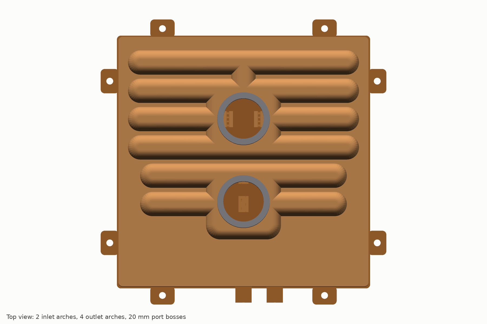

| Deliverable | Files |
|---|---|
| STEP AP214 per part and the full assembly (one node per part), xz-compressed | `cad/out/*.step.xz` (core 7.6 MB compressed, 89 MB expanded; assembly 8.6 MB) |
| Tessellated meshes per part and the four section solids, 0.05 mm chord | `cad/out/*.stl` |
| Build reports: validity, solid count, volume, mass, bounding box; interference and mass checks | `cad/out/*.json`, `cad/out/assembly_report.json` |
| Developed flat pattern of the plenum with fold lines and pierced features | `cad/out/plenum_flat.dxf` |
| Orthographic and isometric views of each copper part and the assembly | `cad/drawings/*.svg` |
| Orifice artworks for laser piercing, separator window pattern, plenum blank | `cad/drawings/*.dxf` |
| Dimension tables per part for the drafter | `cad/drawings/dims_*.csv` |
| Report figures | `cad/renders/*.png` |
| Source | `cad/prism_cad.py`, `cad/parts/*.py`, `cad/assembly.py`, `cad/render_views.py`, `cad/drawings.py`, `cad/README.md` |

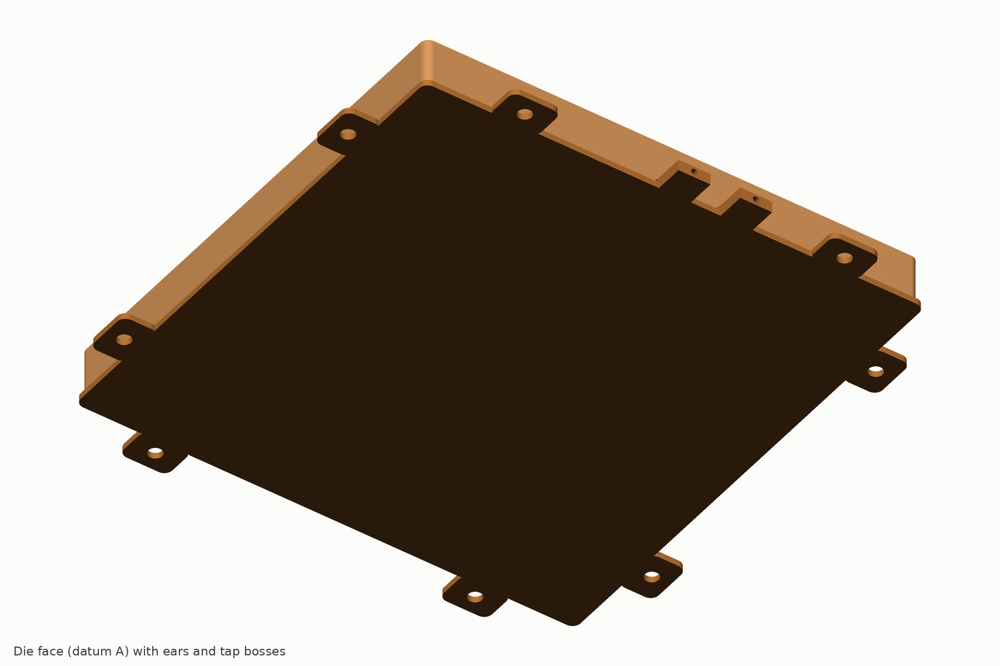

**Checks on the full-resolution build, regenerated with the cap lane's geometry.** All fourteen solids are valid single bodies. Twenty pairs were checked for interference (the stacked copper layers, the cap against the core and against every part inside its skirt, the bosses and the guard against the cap and each other) and all return zero volume. The 121.5 mm skirt sits on the 121.4 mm rim lap face with a 0.05 mm radial gap and clears the separator and grate (121.0) by 0.25 mm, the plenum flange tips by 0.24 mm and the end frames by 0.40 mm; it is notched over the two tap bosses. Height 20.8 mm at the arch and dome crowns, 29.5 mm to the top of the port bosses. Plate mass 1,151 g without stubs, frame or test vehicle (table in section 8.6). Stack: die face 0 | base to 0.85 | fins to 2.80 | land plate to 4.10 | meter web to 4.50 | plenum to 10.30 | separator to 12.10 | cap lid to 13.10, crowns to 20.80 (internal 19.80) | bosses to 29.5.

**Two findings from the regeneration.** First, with half-cup arch ends the straight part of each arch stops at |x| 45 (inlet) and 51 (outlet) while the outermost separator windows reach |x| 48.8 and 54.95, so the outer corners of the four inlet windows at x ±46.3 (1.3 % of their area) and the eight edge outlet windows at x ±53.7 (4.0 %) sit under the arch end wall; the mechanical limits (52 / 58.8) leave room to lengthen the arches by about 1 mm, which the cap and plenum lanes decide at G1 (O-C6). Second, the cap lane's 279 g sums the full lid area and then adds the arch and dome developed areas, counting the lid under their footprints twice; the CAD solid at a uniform 1.0 mm wall is 233.6 g.

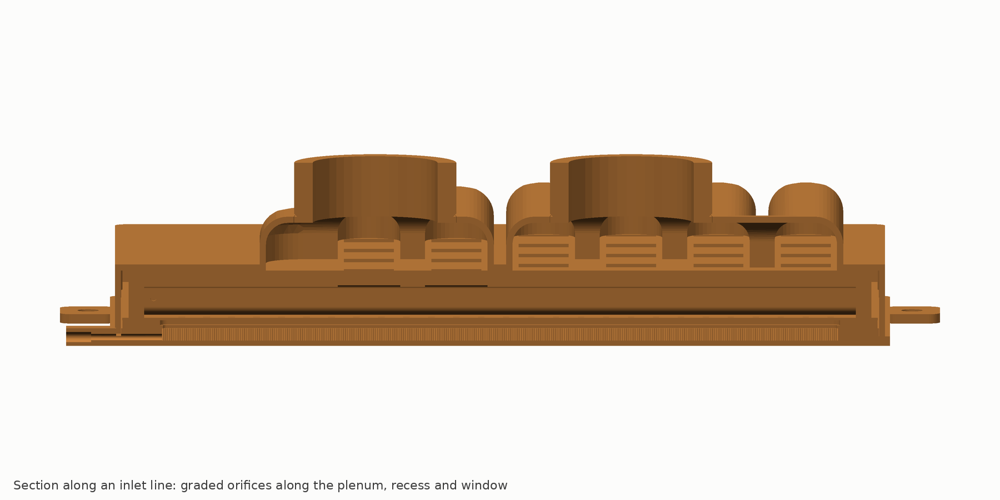

**Known simplifications.** Kerfs are modelled at full depth over the whole fin length (the saw run-out ramp beyond |y| 48.1 mm is not). The 0.15 × 0.08 mm capillary-break scribes, the 0.1 mm orifice corner radii, the plenum wall end tabs and end-frame comb slots are not modelled; orifice areas are within 2 % of the artwork. The guard is a 0.1 mm shell without its corrugated bottom, feet and hook tabs, hung from the dome crown 0.7 mm higher than the lane's feet place it; the cap walls are a uniform 1.0 mm (the drawn part thins to 0.92 at the crowns and 0.70 at the arch ends); the stub-seat counterbores, O-ring grooves and the 316L stubs are not modelled. The outline is 121.0 mm (confirmed by the cap lane) and the pins 2.0 mm at ±57.5 (core lane) where the grate lane wrote 3.0 at ±57; the pins go to G1. The screws and the load frame follow the mechanical lane.

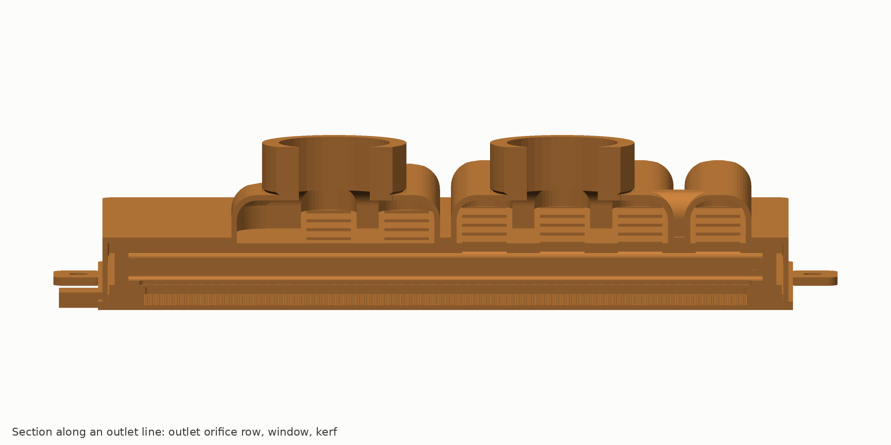

## 10. Verification record, concessions and risks

### 10.1 How the design was stress-tested

The architecture passed five review rounds before this design (`04-verification.md`): a physics check that corrected the model (Darcy friction, isothermal caloric term, PG25 conductivity 0.49 W/m·K, the plate's own two-dimensional penalty rather than CoolIT's calibration-absorbed one); a design panel of eight proposals with independent judges; an adversarial verification across physics, hydraulics, manufacturing, cost and market, and IP; a completeness critic; and a reproducibility audit in which all six final scripts re-ran byte for byte. The largest changes it forced: the 18-line layout became 15 lines with edge outlets; the stamped laminations became a folded plenum and a drawn cap; the doubled outlet header and the outlet orifice row cut segment imbalance from 1.36 to 1.06; jets moved from fin tips to the grate lip; cost was re-based from US$115 to US$165; the US launch was tied to a freedom-to-operate opinion.

The design lanes then re-derived every number on the dimensioned geometry: the core, grate, plenum, mechanical and manufacturing lanes each carry a deviations table against the architecture and an open-items table with the test that closes each item. The performance lane re-ran the benchmark on the as-designed 0.85 mm base and found the architecture's numbers within 0.14 K.

### 10.2 What the design does not win, stated plainly

| Concession | Size | Why it stands |
|---|---|---|
| Price per plate | US$165 vs about US$126 at 100k/yr (+31 %) | fine skiving, two-lamination grate, silver filler, 100 % test; parity on cost per kW of capacity; US$142 on the C2 route |
| No field record | – | first hardware is month 3; 22-plate endurance is months 5–11 |
| Fouling life at equal filtration | 0.15 mm gaps vs 0.2–0.3 | ships with a mandatory 33 µm absolute tray filter (decision D6); dose claim only until E4 |
| Average on a 100 cm² footprint, paste | parity | the fin-field advantage shrinks when CoolIT's heaters are small; we test both vehicles |
| Average at or below 0.5 LPM/kW | loss | the long caloric path of a split-flow plate wins on the average at low flow; maximum still wins |
| CoolIT's 4 kW single-die point | loss with the drop-in core | the metered grate pays its 2.3 kPa and the fin field is oversized for a 50 × 50 die |
| 350 W/cm² at 85 °C case | miss (about 98 °C drop-in, 88 °C filtration-gated grade) | about 16 K better than a split-flow model; a bare-die Tier 3 problem, not the 15 kW test |
| Thermal buffering of power steps | 40 % less copper over the die | not sold as a buffer; the loop handles transients |

### 10.3 Risk register (ranked)

| # | Risk | Likelihood / impact | Early warning | Fallback |
|---|---|---|---|---|
| R1 | Tie braze: voids, wicking, kerf damage; per-strip detection fails at the 0.85 mm base | medium / critical | E1 at M3 | routes B, C, D; base 1.0 (+0.7 K); no-kerf core outside the US only |
| R2 | Segment uniformity worse than 1.15 | low–medium / +1–2 K on the maximum | E2 at M3 | re-artwork the outlet row (+0.5 kPa) |
| R3 | Meter discharge CFD shows fin-top velocity above 0.5 m/s | medium / erosion, IP | CFD at M2 | wider lip, lower orifice velocity |
| R4 | Benchmark ambiguity used against us | high / credibility | reviewers | two vehicles, R'' per area, eight-TC replication, purchased plates, standing offer to test any CoolIT plate |
| R5 | OCP's recommended interface material is a paste | medium / average margin falls | read OCP §5.2 in M1 | lead with maximum, uniformity, dP, capacity |
| R6 | Fouling or kerf impaction | low–medium / life claim | E4 | dose claim only; mandatory cartridge |
| R7 | Customer mandates a nickel wetted path | medium / socket access | statement-of-work reading | route C with pre-plated nickel |
| R8 | IP: Split-Flow, TW I606224, Microfabrica | high / US timing | FTO at M4 | non-US first; US from Sep 2028; indemnity insurance |
| R9 | Cost above US$175 at 100k | medium / channel | RFQs at M1 | C2 route; per-SKU tooling limited to the meter web |
| R10 | TTV heaters crack at 150 W/cm² | medium / schedule | commissioning M3–4 | copper-block cartridge vehicles |
| R11 | Supplier capacity (furnaces, skivers) | medium / schedule | RFQs | two sources each; long-lead orders at M1 |
| R12 | Micro-channel lids displace lidded plates at NVIDIA | medium–high / rank A2 | customer signals | D7 lid-insert study; G2 pivot decision |
| R13 | Section 232 classification | medium / landed cost +US$50–110 | CBP ruling | site decision tree |
| R14 | CoolIT publishes a better plate in its own OCP format | medium / marketing | market | R+ and liquid-metal data in reserve; transparency |

### 10.4 What has not been done

No hardware, no three-dimensional CFD, no reading of the OCP specification text itself (it could not be fetched from this environment; its recommended interface material and case definition matter), no legal opinion. The first three months of the programme exist to close exactly these gaps.

## 11. Innovation register

The elements below are what a competitor must copy to match the plate, with the protection route the architecture assigns to each.

| # | Element | What it does | Why it is new | Protection |
|---|---|---|---|---|
| 1 | Tied fin tips: every fin brazed to the grate lands over ≥ 70 % of its length | base sees pressure only between ties 0.3 mm apart; 0.85 mm base with zero pressure bow; MAWP carried by the ties | skived plates are open-topped; the few fin-to-lid braze proposals (Nidec) have no manifold on the tie | file (filing 1), narrow with numeric limits |
| 2 | Kerfed skived field with a metered grate | 7.7 mm flow length at 0.15 mm gaps without the dP of a long split-flow path; every segment starts at inlet temperature | manifold microchannels exist (Cooligy, JetCool); none is a brazed skived field with kerf-fed cells and a stepped grate | filing 1 |
| 3 | Inertial meter off the braze plane, graded to the plenum profile | ±2.2 % per-orifice uniformity at every flow because both the meter drop and the plenum profile scale with velocity squared; braze cannot reach the orifices | microjet plates put the orifices in the braze plane; grading is usually viscous (flow-dependent) | filing 1; artwork tool as trade secret |
| 4 | Jets landing on a grate lip over a recess, not on the fins | fin-top velocity ≤ 0.5 m/s, no erosion, clears the Microfabrica family | the usual impinging-jet-on-fin arrangement is both an erosion risk and an IP risk | filing 1; chart after CFD |
| 5 | Flux-graded flow length (5–6 mm above 250 W/cm², 12 mm below 50) | zoning by cell length rather than by flow alone; die block takes 85–90 % of the flow with HBM never downstream of a die | partly anticipated (Cooligy, Toyota, HUST) | defensive publication |
| 6 | Doubled outlet header plus a 0.5 kPa outlet orifice row | balances the two fin segments either side of each line (1.36 to 1.06) at no height cost | segment-level imbalance is unaddressed in manifold plates | filing 1 |
| 7 | Folded 0.8 mm plenum with bleed holes and end frames | 15 channels at 7.7 mm pitch from one sheet; no stamped webs; internal joints cannot leak outward | stamped laminations were found unmakeable at these webs | know-how |
| 8 | Drawn skirted cap with one external seam | the only joint that can leak to the outside is a lap seam with a safety factor of 4.5–6.5 | most plates have four to six external seams | know-how |
| 9 | Fin-field pressure-drop taps | a fouling signature read at the fins, not at the ports; service on evidence rather than on hours | plates have no in-core telemetry | publish via OCP |
| 10 | Capillary-break grooves and masked lands | keep filler out of windows and orifices in a single braze cycle | – | trade secret |
| 11 | Differential-expansion braze fixture (TZM springs, graphite platens) | 0.08 MPa on the stack insensitive to shim error; 60 plates per load | dead-weight fixtures are impractical at this pressure | trade secret |
| 12 | Per-strip bulge detection at proof (confocal, 1 µm) | finds the one unbonded land strip that passes leak and proof | the governing defect of any tied plate; no published control | trade secret |
| 13 | Filtration ladder: 50 µm guard in the boss plus a 33 µm tray cartridge | lets the fine field be sold with a stated life | – | publish via OCP |
| 14 | Artwork-per-SKU zoning | a new package is a laser file and two to three weeks, not a die | – | trade secret (tool) |
| 15 | Transparent test method: two vehicles, three dP boundaries, independent repeat | makes the comparison un-attackable | – | defensive publication after clearing US 12,446,195 |

The innovation lane (`design/DDD-innovation.md`) carries each of the ten design-level elements as a full card: the problem it solves, the mechanism with its dimensions, the quantified benefit with the script it comes from, the closest prior art and the difference, a novelty confidence (high, medium, low, none) under the freedom-to-operate caveat, and the test that proves it. Its headline judgement: the strongest patentable element is the stepped recess with lip landing and the off-braze-plane meter (medium confidence, the core of filing 1); the short flux-graded flow length and the tie itself are low-confidence as novelty and are positioned as a proven subset done well; the thin-base rating logic, the per-strip screen and the artwork solver are trade secrets. It also lists what is deliberately not claimed (skived copper, vacuum brazing, split manifolds as such, orifice-compensated headers, PCM and liquid-metal interfaces) so that marketing and the filing never overreach.

**Stretch innovations, not in Rev A** (DDD-innovation section 4), carried as options for a Rev B once the braze is proven:

- **S1. Chevron-staggered lines.** Offsetting adjacent lines by half a segment along y would put the hot end of each cell beside the cold end of its neighbour 0.3 mm away, cutting the conduction length that smooths the kerf-to-kerf ripple from the 3.7 mm half-pitch to about 2 mm. Ripple smoothing scales with length squared, so the 5.4 K peak-to-peak ripple could halve, worth about 1.3 K on the maximum and nothing on the average. Cost: gang saws cut straight lines, so the kerfs become wire-EDM or laser work and the plenum channels become chevrons.
- **S2. Viscosity-driven self-balancing for zoned SKUs.** The fin drop is viscous, and PG25 viscosity falls about 30 % between 35 and 50 °C, so a segment under a hotter zone would draw 10 to 15 % more flow by itself if part of the inertial meter budget were moved into a laminar element. The price is that the plenum-profile sensitivity the velocity-squared meter cancels comes back in proportion.
- **S3. A 0.60 mm base.** Worth about 0.8 K on every interface. The ties make it structurally free, but one unbonded strip would then collapse at or below working pressure, so it needs a second independent 100 % tie screen (lock-in thermography on the as-brazed face) before it can be rated. It is the natural follow-on once E1 has shown what the confocal scan can see.

## 12. Applications

| Rank | Application | Variant | Entry |
|---|---|---|---|
| A1 | Hyperscaler custom ASICs (TPU, Trainium, Maia, MTIA class) | PRISM-15 or PRISM-G zoned; R+ over the dies with the tray filter | samples M12–15, qualified M18–24, volume 2029 |
| A2 | NVIDIA reference designs | PRISM-G Tier 1/2; micro-channel-lid insert (Tier 3B) | through NVIDIA thermal engineering; platform 2029–30 |
| A3 | 15–30 kW modules, Kyber-class blades, wafer-scale tiles | PRISM-15, -15-HF, -W | 2028–29 |
| A4 | CPU, NVSwitch, co-packaged optics | PRISM-S | rack kits only |
| P1 | 800 VDC rectifier and solid-state-transformer SiC modules | PRISM-DC direct-substrate cooler | demonstrator M9–12 with a module partner; volume 2028+ |
| P2 | 800 VDC shelf plates | keyed-orifice plate | rack kits only |
| P3 | SiC traction | PRISM-A | licence 2028, vehicles 2030–31 |

**AI data centres first.** The plate is sized, zoned and tested for the 15 kW class and scales to the GPU envelope with the same core, grate and cap tooling; only the meter artwork and the pedestal change per package. The buyers who control package, tray and loop (hyperscalers) can adopt the tray filter and the R+ grade; NVIDIA is reached through its thermal engineering team, with Group-A houses as factories, not as licensees.

**Power electronics second.** On a 1200 V SiC half-bridge (1.62 cm² of SiC per switch, silver-sintered Si₃N₄ AMB, PG25 at 45 °C) the PRISM-DC core cuts the junction-to-coolant rise from 31.4 to 22.8 K per 400 W switch, carries 1.38× the loss per cm² of SiC at 150 °C junction, and extends power-cycling life about four to five times at equal loss (ΔTj⁻⁴·⁴ to ⁻⁵ scaling of a 27 % smaller swing). Under a gap pad the advantage vanishes. "SSD converters" is read as SiC converters; solid-state transformers and DC breakers (15–25 kW of heat per MW on isolated substrates) fit; storage drives at 1 to 2 W/cm² do not.

## 13. Programme, gates, budget and decisions

### 13.1 Roadmap (M0 = November 2026)

| Months | Work | Gate |
|---|---|---|
| 0–1 | RFQs, long-lead orders, read OCP §5.2 and the PG25 guidelines, FTO claim pulls, CBP ruling request, NDA envelope requests | – |
| 1–3 | E0 purchased plates, E1 braze coupons, E2 water table and CFD; design freeze preparation | **G1 (M3) Rev A freeze**: join route, base 0.8 vs 1.0, C2 go/no-go, outline and pin reconciliation. Kill if no route passes E1 by M5 |
| 3–5 | Build A, 12 plates; E3 test-vehicle commissioning; E4 fouling starts | FTO opinion at M4: US demonstration decision |
| 5–6 | 5 plates × 3 re-mounts, paste and pad, both vehicles | **G2 (M6)**: pad ≤ 31 / ≤ 36 K and paste ≤ 33 K, else re-scope the claim or pivot; at least one letter of intent |
| 6–9 | Build B, 20 plates on production-intent dies; E5 endurance; independent laboratory | **G3 (M9)**: repeat within ±1.5 K |
| 9–12 | OCP-format report; R+ and liquid-metal stretch data | **G4 (M11–12)**: public at OCP Global Summit 2027 |
| 12–18 | 300–500-plate pilot at the contract manufacturer; PPAP; samples to two hyperscaler programmes; PRISM-G and PRISM-DC samples | **G5 (M18)**: qualified product |
| 18–36 | ramp 10k to 100k per year | volume 2029 |

### 13.2 Experiments

| # | Experiment | When / cost | Pass criterion |
|---|---|---|---|
| E0 | Buy 2–3 incumbent GPU plates, a CoolIT 4 kW-class plate and UQD08 pairs; measure R, dP, Cv, height, mass | M0–2 / US$40–60k | rig repeatability ≤ 1 K |
| E1 | Tie-braze matrix: kerfed coupons × routes A/B/C (+ belt C2) × base 0.8/1.0 × potted/unpotted kerfing × tip-plane tolerance × fixture pressure | M0.5–3 / US$120k | every land strip ≥ 70 % bonded over any 10 mm; unbonded strip detected at 0.8 mm; burst ≥ 4.5 MPa; flatness ≤ 20 µm |
| E2 | Water table and single-cell CFD of orifice, lip, window, kerf | M1–3 / US$90k | segment max/min ≤ 1.15 at 18 LPM; fin-top velocity ≤ 0.5 m/s |
| E3 | Test-vehicle commissioning (TTV-A, TTV-100, TTV-A2, TTV-25, TTV-D), D5470 interface metrology, pulsed-power transient | M2–5 / US$200k | heat capture ≥ 98 %; re-mount repeat ≤ 1 K |
| E4 | Dose-equivalent fouling (100× ISO 12103 + CuO + EPDM, 1,000 h) with fin-field dP taps; lip erosion at 1×/1.5×/2× flow | M3–10 / US$100k | fin-field dP ≤ +10 %; dT ≤ +1 K; no measurable erosion |
| E5 | Endurance on 22 plates; coolant chemistry; shock and vibration; orientation | M5–11 / US$250k | reliability targets of architecture 10.1 |
| E6 | Freedom-to-operate claim pulls, charts, opinion | M0–4 / US$150–250k | clear, design-around or launch-date decision |

### 13.3 Budget and probability

Twelve months: US$7.3–8.9 M before contingency, US$8.4–10.7 M with 15 to 20 % contingency. Main lines: labour US$3.9–4.1 M (18 FTE); rigs, test vehicles and IR station US$1.4–1.6 M; confocal, helium and D5470 US$0.3–0.6 M; Build B dies US$0.25–0.6 M; prototypes US$0.35 M; reliability and chemistry US$0.38–0.5 M; IP US$0.25–0.35 M; independent laboratory US$0.15 M; CFD, FEA, CT, fit-out, compliance, E0 US$0.3–0.7 M. Tranche to G1: about US$2.3 M. Months 12–18 add US$3.0–3.8 M; the 18-month total is US$11.4–14.5 M. The lean option is about US$8.3 M with contingency and withdraws the above-18 kW and 350 W/cm² claims.

Probabilities (model × programme factors 0.8 × 0.9): decisive pad result at M12 0.43; paste average win on the parity vehicle 0.58; paste maximum win 0.65; pad average, maximum and dP together 0.68; paste average win on the 100 cm² vehicle 0.32 (R grade) or 0.50 (R+). The dominant failure mode is a one-to-three-month slip at E1 or at test-vehicle commissioning, not a thermal miss.

### 13.4 Decisions requested

| # | Decision | Recommendation |
|---|---|---|
| D1 | Public claim scope | Scoped claim, released only after G2 measurement: at CoolIT's published point PRISM beats CoolIT like-for-like on average and maximum case temperature, uniformity, case-limited capacity and inlet headroom; its maximum is lower at every OCP flow; its plate pressure drop is below any credible reconstruction; lower at the bar, parity or better on mass, parity on cost per kW. It costs more per plate, ships with a tray filter and has no field record. No claim on the 4 kW point, the low-flow average or the 100 cm² average |
| D2 | Channel and moat | Build and supply through a non-Group-A contract manufacturer to hyperscalers, and to NVIDIA through its thermal engineering team; no licence to Group-A houses |
| D3 | Budget and gating | Tranches: US$2.3 M to G1 at M3, the rest released on a G1 pass; full scope US$8.4–10.7 M |
| D4 | Rev A stack | Vacuum BAg braze as the baseline (US$165); the silver-free Cu-Sn belt route (US$142) decided at G1 on E1 coupons |
| D5 | US launch and build site | No US offers, sales or evaluation units before the FTO opinion, and no US sale before 10 September 2028 unless it clears; Vietnam or Mexico build first, following a CBP binding ruling; Taiwan only after TW I606224 is charted |
| D6 | Filtration | Tray cartridge mandatory and supplied (≥ 150 cm², 33 µm absolute); the product is "mechanically drop-in, ships with a tray filter kit" |
| D7 | Hedges | US$0.4–0.6 M micro-channel-lid insert design study plus a two-phase watching brief |

### 13.5 Organisation

Eighteen FTE: programme lead 1; thermal-fluids 2 (chief architect within); mechanical and FEA 2; manufacturing and supplier 2; supplier-quality engineer at the contract manufacturer 1; test laboratory 3; reliability, materials and chemistry 1.5; quality 1; business development and customer engineering 1.5; applications and OCP 1; compliance 0.5; cost engineering 0.5; IP coordination 0.5 with outside counsel. Gate board: the line manager (chair, kill authority), a finance delegate, the programme lead, the chief architect, an ex-OEM thermal architect voting on technical gates, and patent counsel advising.

## 14. Design status and open items at this release

**Complete to design-definition level:** core (DDD-core), grate (DDD-grate), plenum and separator (DDD-plenum), cap, bosses, guard and seam (DDD-cap), mounting and integration (DDD-mech), manufacturing package (DDD-mfg), parametric CAD with drawings, predicted datasheet (DDD-perf), innovation register (DDD-innovation). **Not started:** PRISM-G product artwork, PRISM-DC detail.

The cap lane reported last (`design/DDD-cap.md`): 10 × 7.7 mm arches, 35 mm cross domes with an outlet spine, bosses at y −20 and +21, a 121.5 / 123.4 skirt, 5 × 8 separator windows, an in-dome guard and a 279 g cap, at 20.8 mm to the bar. Its values are in `params.json` and the CAD is regenerated from them (section 9).

**Inter-lane conflicts to close at G1 (F9, O-F4):**

| Item | Lane values | Recommendation |
|---|---|---|
| Grate and separator outline | 122.6 (grate) vs 121.0 (core, CAD) | **closed by the cap lane (IR-C2): 121.0 ± 0.08**, 0.25 mm inside the 121.5 skirt; the grate lane's drawing is updated at G1 |
| Datum pins | 2.0 at ±57.5 (core, CAD) vs 3.0 at ±57 (grate) | 2.0 H7 alumina; one round, one slotted |
| Separator thickness and height | 1.8 mm (plenum lane) vs 1.5 (architecture) | keep 1.8 copper; the cap lane's 7.7 mm arches restore 20.8 mm at the bar; 0.6 mm 316L stays the mass option |
| Separator windows | 5 × 10 (plenum) vs 5 × 8 (cap IR-C1) | 5 × 8; plenum top-flat windows stay 5 × 10; re-run plenum_sep.py |
| Port boss positions | (0, −14) / (0, +28) provisional vs (0, −20) / (0, +21) (cap) | cap lane; inside the mechanical keep-in; mech IR-C3 to confirm the frame window |
| Guard | in-dome cup 17.4 cm² at 0.40 kPa (GUARD-C) vs stub-housing 25 cm² at 0.2 kPa (GUARD-A) | decide with the first customer ICD (O-C3); the plate is the same either way |
| Mass | 1,307 (cap lane) or about 1,262 with the CAD cap mass, vs 1,240 budget and 1,400 limit; up to 1,392 with the product frame | 0.6 mm 316L separator (−106 g) is the recovery; a 0.9 mm cap sheet is ruled out by the arch-end thinning limit |
| Ear hole | 3.4 (core) vs 4.5 (mech IR-M1) | 4.5 +0.10/−0 |
| Outlet window positions | +9/+23/+37/+51 (plenum) vs +7/+21/+35/+49 (mech IR-M3) | +7/+21/+35/+49 (already in params.json and CAD); re-run plenum_sep.py |
| Fixture pressure | 0.2 MPa (architecture) vs 0.08 (mfg) | 0.08; E1 factor 0.04/0.08/0.12 |
| Test order | architecture 5.3 vs mfg D-F4 | mfg order (He dry before any wet step; IR before the fly-cut) |

**Open items and the test that closes each** (consolidated; the lane tables hold the full list):

| ID | Item | Closes at |
|---|---|---|
| O1 | Recess depth 0.70–0.90 and lip width 0.70–0.80: fin-top velocity ≤ 0.5 m/s, jet footprint on the lip | E2 CFD and PIV, M2 |
| O2 | Orifice discharge coefficient 0.65–0.80 vs Reynolds, direction, laser vs die edge | E2 coupons, M2 |
| O-F1 | Fixture pressure vs tie-bond fraction and plenum corner set | E1, M3 |
| O-F2 | 25 µm perforated vs 12–15 µm foil at the fin tips | E1 sections, M3 |
| O-F3, O-C4 | Cap draw trial on soft tools: arch-end thinning map ≥ 0.70, valley r 0.5 restrike, land flatness 0.05, skirt inner 121.50 ± 0.03 | Build A, M3–4 |
| O-C1 | Outlet dome walls and top ligaments with the brazed boss ring: 28–48 MPa bound at design burst | E1 FEA, M2 |
| O-C2 | Skirt wall with a wetted stack-edge cavity; lap-seam fillet continuity by section on the first 5 plates | E1 FEA, E0 |
| O-C3 | GUARD-C in-dome cup vs GUARD-A stub housing; fouling dose on the chosen element | first customer ICD, E4 |
| O-C6 | Arch ends vs the outermost separator windows (1.3 % / 4.0 % of window area under the end wall): lengthen the arches by about 1 mm inside the 52 / 58.8 limits, or trim the windows | cap and plenum lanes, G1 |
| O5, O6 | Lamination registration ±0.03; capillary-break effectiveness; orifice area change ≤ 1 % through braze | E1 CT and vision, M3 |
| O7, O-F6 | Web-to-land bypass ≤ 0.2 % of flow; dP Cpk budget | E2 dye on Build A, M4 |
| O-F7 | Flush recipe clears 10,080 kerf sites; chip CT | M4 |
| O-M1 | Test-vehicle spring rate measured; 2,011 ± 40 N | E3 rig build |
| O-M2 | Clamp and thermal bow FEA; heated pressurised flatness scan on 5 plates; 2-side vs 4-side bearing | E1 M2, E3 M4 |
| O-M3 | Shock and vibration levels from ORv3, OCP cold-plate white paper, GR-63-CORE | M5 |
| O-M7 | Thermocouple layout confirmed against a purchased CoolIT vehicle and OCP §5.2 | E0, M1 |
| O8 | Lip erosion at 2.2–2.5 m/s jets, 1,000 h | E4, M10 |
| O9, O-F9 | Perforating-die transition for the meter web after artwork freeze | M6–9 |
| O-F10 | Second-source list; CBP ruling on the build site | M6 |

## Appendix A. File index

| Path | Content |
|---|---|
| `docs/cooling/README.md` | map of the package |
| `docs/cooling/01-benchmark-and-requirements.md` | CoolIT reconstruction, OCP arbiter, requirements |
| `docs/cooling/02-physics-basis.md` | the physics the design rests on |
| `docs/cooling/03-architecture.md` | architecture of record, PRISM-15 Rev A (audited) |
| `docs/cooling/04-verification.md` | how the architecture was stress-tested |
| `docs/cooling/05-detailed-design.md` | design definition synthesis (this report's source for sections 3, 6, 7, 8, 14) |
| `docs/cooling/model/coldplate_model.py`, `model_output.md` | the calibrated 1-D / network / 2-D model, v3 |
| `docs/cooling/design/params.json` | the CAD parameter file, single source of truth for geometry |
| `docs/cooling/design/DDD-core.md`, `DDD-grate.md`, `DDD-plenum.md`, `DDD-cap.md`, `DDD-mech.md`, `DDD-mfg.md`, `DDD-perf.md`, `DDD-innovation.md` | design-definition documents per lane with their scripts, parameter files and outputs |
| `docs/cooling/design/artwork_prism15_ttv.csv`, `.dxf` | the 15 kW orifice artwork (ART-TTV-15-A) |
| `docs/cooling/design/artwork_prism_g_example.csv`, `.dxf` | zoned GPU artwork example |
| `docs/cooling/design/bom.csv` | 25-line bill of materials |
| `docs/cooling/design/perf_datasheet.py`, `.out` | the predicted datasheet of section 5 |
| `docs/cooling/cad/` | parametric CAD, outputs, drawings, renders, README |
| `docs/cooling/report/PRISM-15-RevA-design-report.md`, `.pdf` | this report and its source |
| `docs/cooling/appendix/` | research, physics, design-panel, verification and judge evidence with scripts |

## Appendix B. Conventions

Units are millimetres unless stated. Temperatures in °C, differences in K. PG25 is 25 % propylene glycol in water by volume, inhibited, with conductivity 0.49 W/m·K at 45 °C. "Case-to-inlet" is the heater-surface or package-case temperature minus the plate inlet coolant temperature, as the OCP test specification defines it, with the thermal interface included. R is that difference divided by power (K/W); R'' is R multiplied by the heated area (cm²·K/W). "CoolIT measured" values are the three figures in CoolIT's June 2026 tech brief; "CoolIT-like" values are our calibrated model of a split-flow plate and are not CoolIT's numbers. Axes: X along the fins (across the fifteen lines), Y along the lines, Z up from the die face, origin at the centre of the fin field.

